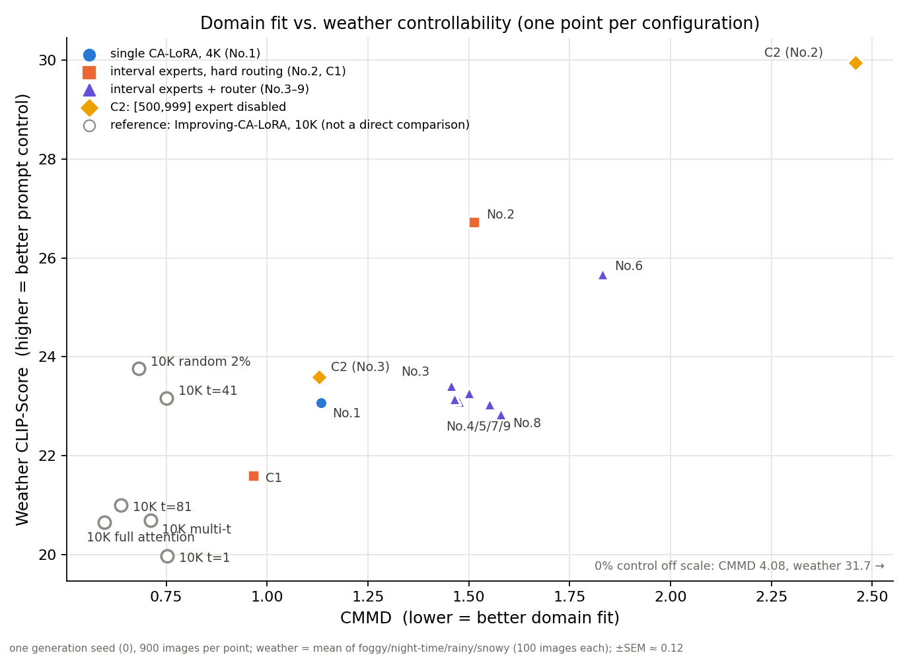
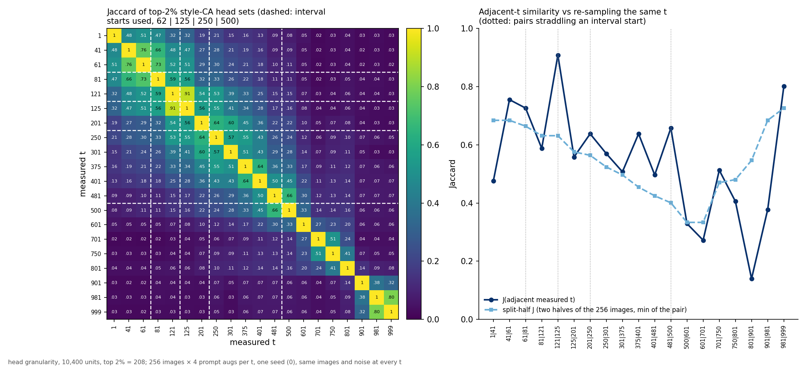
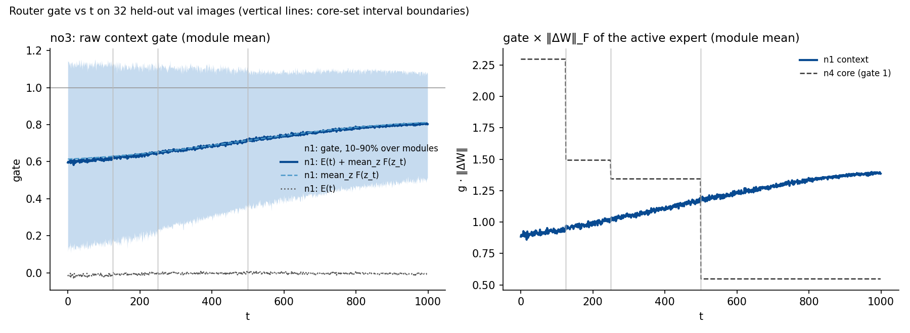

# CA-LoRA-TSM

CA-LoRA whose concept-aware head selection is made per timestep interval and combined by a TSM-style router.

## TL;DR

- **The selected heads do depend on t, but there are no blocks to find.** The top-2% style-CA head set drifts smoothly with the noise level: its Jaccard with the t = 81 set is 0.59 at t = 121, 0.33 at 250, 0.11 at 500 and ≤ 0.05 from 601 on. The matrix has no block edge at any interval boundary we used. From t ≈ 400 to 750 roughly half of the set is sampling noise (split-half Jaccard 0.33–0.48).
- **Per-interval selection moves the result along the trade-off curve. It does not improve it, and the router adds nothing.** n4 experts with per-interval selection and hard routing (No.2) give the best weather controllability (CLIP 26.71 vs 23.07 for single CA-LoRA, No.1), but CMMD is 34% worse (1.514 vs 1.133). None of the seven router configurations (No.3–9) improves on that. No.6 is dominated by No.2. The other six have 29–39% worse CMMD than No.1 and gain at most +0.34 weather CLIP (≈ 1.7 SEM).
- **C1 verdict: the gain came from per-interval training, so the core claim is rejected.** C1 uses the same four intervals but takes every selection at t = 81. It has the best CMMD of all configurations (0.966, vs 1.133 for No.1, the best of No.1–9). Changing the selection per interval (No.2 vs C1) only trades CMMD for controllability: +5.1 weather CLIP for 57% worse CMMD.
  *Honesty note:* every number comes from one generation seed and there is no mIoU. CMMD has no error bar, so we cannot show that the C1-vs-No.1 gap (0.17) exceeds seed noise. The robustness sweep was not run, and it is the experiment that tests this repo's original goal ("a training method that tolerates an imperfect choice of t") directly.



*Domain fit (CMMD, lower is better) against weather-prompt controllability (CLIP-Score, higher is better), with the same axes as Improving-CA-LoRA's figure. Filled points are this repo's configurations (4K steps per expert). Hollow grey points are Improving-CA-LoRA's single LoRAs trained for 10K steps, shown for reference only. None of this repo's configurations beats C1 on CMMD, and every point with more controllability pays for it in CMMD.*

## Motivation

CA-LoRA ([arXiv:2503.22172](https://arxiv.org/abs/2503.22172)) measures concept-awareness at a single timestep t and puts sliced LoRAs on the top-2% heads. That t (81) was picked from figures by eye, and it decides which parameters get trained at all. [Improving-CA-LoRA](https://github.com/chs35/Improving-CA-LoRA) tried to replace the heuristic with a quantitative criterion. The criterion's top-ranked t did not beat t = 81: the best t depended on the metric. Picking t more cleverly did not work.

This repo therefore asks a different question. Instead of how to choose t better, it looks for **a training method that does not care much whether t was chosen well**. That would remove the need to search for t again for every new domain or backbone.

## Core claim

> Which heads are concept-sensitive depends on the noise level, so each timestep interval should get its own **selection set**, not just its own LoRA weights.

This is what separates the method from timestep-expert methods such as TimeStep Master (TSM), eDiff-I and ERNIE-ViLG 2.0: they split the weights by timestep but keep one parameterisation. The experiment was designed so that the claim can fail. **Control C1** keeps every part of the per-interval pipeline (same intervals, same 4K steps per expert, same seed, hard routing) except that every interval's selection is taken at t = 81. If C1 matches the best configuration, any gain comes from per-interval *training* and the claim is rejected (design §5.2, scenario 7). Control C2 switches off the [500, 999] expert to test whether high-noise experts are harmful (design §3.4).

## What differs from TSM

- **Per-interval selection.** Each interval's expert is a sliced LoRA on the top-2% CA heads measured at a representative t inside that interval: n3 [81, 375, 750], n4 [81, 201, 375, 750], n5 [41, 81, 201, 375, 750]. Experts on the same matrix therefore sit on different heads, so the router emits one raw gate per projection matrix and context set, not one per adapter.
- **Non-uniform intervals.** The range is halved from the top, so the low-noise end gets finer experts: n3 = (250, 250, 500), n4 = (125, 125, 250, 500), n5 = (62, 63, 125, 250, 500) timesteps. TSM splits uniformly.
- **Boundaries recorded in log-SNR.** Every selection and expert file stores its interval in log-SNR (t = 62 → 2.74, 125 → 1.84, 250 → 0.73, 500 → −0.96; ends 7.07 / −5.36), so the definition carries over to a backbone with a different t parameterisation. The halving is *not* uniform in log-SNR (widths 4.3, 0.9, 1.1, 1.7, 4.4).
- **Text encoders frozen.** LoRAs go on the UNet attention only (SDXL convention), so prompts need not be re-encoded at every interval switch.

## Results

SDXL base + Cityscapes, style-axis CA, head granularity (top 2% = 208 of 10,400 head units), sliced LoRA rank 64. The full table, including per-condition stds, is in [`results/summary.csv`](results/summary.csv).

| Config | Experts | Routing | Active / nominal heads | CMMD ↓ | In-domain CLIP | Weather CLIP ↑ | foggy | night | rainy | snowy |
|---|---|---|---|---:|---:|---:|---:|---:|---:|---:|
| No.1 | n1 (CA-LoRA, t=81), 4K | single | 2% / 2% | 1.133 | 22.57 | 23.07 ± 0.13 | 25.94 | 20.49 | 23.33 | 22.51 |
| No.2 | n4 | hard | 2% / 8% | 1.514 | 24.58 | **26.71 ± 0.11** | 27.34 | 25.03 | 27.35 | 27.13 |
| No.3 | n1+n4, core n4 | router | 4% / 10% | 1.457 | 22.71 | 23.41 ± 0.15 | 25.05 | 21.36 | 24.00 | 23.23 |
| No.4 | n1+n3+n4, core n4 | router | 6% / 16% | 1.501 | 22.99 | 23.27 ± 0.15 | 25.00 | 21.15 | 23.70 | 23.22 |
| No.5 | n1+n4+n5, core n4 | router | 6% / 20% | 1.476 | 22.72 | 23.10 ± 0.15 | 24.80 | 20.82 | 23.74 | 23.04 |
| No.6 | n3+n4+n5, core n4 | router | 6% / 24% | 1.832 | 24.29 | 25.67 ± 0.12 | 27.11 | 23.54 | 26.46 | 25.57 |
| No.7 | n1+n4+n5, core n5 | router | 6% / 20% | 1.464 | 22.74 | 23.15 ± 0.15 | 25.00 | 20.97 | 23.65 | 23.00 |
| No.8 | n1+n3+n4+n5, core n4 | router | 8% / 26% | 1.580 | 22.51 | 22.84 ± 0.15 | 24.75 | 20.68 | 23.13 | 22.81 |
| No.9 | n1+n3+n4+n5, core n5 | router | 8% / 26% | 1.551 | 22.78 | 23.04 ± 0.14 | 24.85 | 20.90 | 23.34 | 23.08 |
| C1 | n4 intervals, every selection at t=81 | hard | 2% / 8% | **0.966** | 22.33 | 21.59 ± 0.14 | 24.94 | 19.62 | 22.69 | 19.09 |
| C2 (No.2) | No.2 with n4_i3 [500,999] off | hard | 2% / 8% (0% on [500,999]) | 2.459 | 27.29 | 29.95 ± 0.09 | 31.62 | 28.31 | 30.18 | 29.70 |
| C2 (No.3) | No.3 with n4_i3 [500,999] off, router retrained | router | 4% / 10% (2% on [500,999]) | 1.129 | 22.88 | 23.60 ± 0.13 | 25.74 | 21.84 | 24.12 | 22.69 |

Reference only: Improving-CA-LoRA, a single LoRA trained for **10K** steps, which is **not a direct comparison** (design §5.1: every configuration here uses 4K steps per expert to take step count out of the comparison):

| Config | Experts | Routing | Active / nominal heads | CMMD ↓ | In-domain CLIP | Weather CLIP ↑ | foggy | night | rainy | snowy |
|---|---|---|---|---:|---:|---:|---:|---:|---:|---:|
| base SDXL | no LoRA (0%) | — | 0% / 0% | 4.078 | 28.81 | 31.68 ± 0.08 | 32.86 | 30.26 | 32.03 | 31.56 |
| 10K t=81 | single LoRA, style CA t=81, 10K | single LoRA | 2% / 2% | 0.638 | 22.08 | 21.00 ± 0.14 | 23.79 | 20.45 | 20.75 | 19.02 |
| 10K t=41 | single LoRA, style CA t=41, 10K | single LoRA | 2% / 2% | 0.751 | 23.18 | 23.16 ± 0.13 | 24.73 | 23.21 | 22.37 | 22.36 |
| 10K t=1 | single LoRA, style CA t=1, 10K | single LoRA | 2% / 2% | 0.752 | 21.62 | 19.96 ± 0.12 | 23.15 | 18.08 | 20.07 | 18.55 |
| 10K multi-t | single LoRA, style CA top-3 aggregate, 10K | single LoRA | 2% / 2% | 0.711 | 22.64 | 20.69 ± 0.11 | 23.15 | 19.70 | 20.80 | 19.11 |
| 10K random 2% | single LoRA, random 2% heads, 10K | single LoRA | 2% / 2% | 0.681 | 22.99 | 23.76 ± 0.12 | 25.88 | 22.68 | 25.04 | 21.46 |
| 10K full attention | LoRA on all attention, 10K | single LoRA | 100% / 100% | 0.596 | 21.84 | 20.65 ± 0.12 | 24.31 | 18.87 | 21.53 | 17.87 |

**Conditions.**

- **One generation seed (0)** per configuration and one LoRA training seed (0). No seed-to-seed variance was measured.
- **900 images** per configuration (500 in-domain + 100 for each of foggy / night-time / rainy / snowy), SDXL 1024 px, Euler 25 steps, guidance 5.0. CMMD is computed against 500 Cityscapes val images. CLIP is ViT-L/14.
- **±** is the per-image sampling SEM of the weather mean, `sqrt(Σ_c s_c²/n_c)/4`. It is not a seed spread. CMMD has no error estimate.
- **Fostering: 4K steps per expert, on that expert's own interval** (batch 1, lr 1e-4, constant). Nominal fostering steps per configuration = 4K × experts: 4K for No.1, 16K for No.2 and C1, 20K for No.3, 32K for No.4, 40K for No.5 and No.7, 48K for No.6, 52K for No.8 and No.9. Experts with the same interval and selection are shared, so the main runs have only 8 unique experts (7 trained, plus the imported n1; 32K steps), plus 4 for C1 (16K). Routers: 1000 steps, batch 8, experts frozen.
- **Parameters.** "Heads" counts the 208-of-10,400 head units per expert (2%). *Active* is the share in use at any given t (one expert per set); *nominal* is the share stored. One expert is 7.75 M parameters, about 0.3% of the SDXL UNet.
- **No mIoU.** The design asked for mIoU alongside CMMD. It was not computed, so the table cannot say which point on the trade-off gives better segmentation training data.

### Diagnosis: t × t Jaccard of the selection sets



*Left: Jaccard of the top-2% style-CA head sets for every pair of the 20 measured t (256 images × 4 prompt augmentations per t, the same images and noise at every t, seed 0). The dashed lines are the interval starts actually used. Right: Jaccard of each adjacent pair of measured t against the split-half Jaccard (the two 128-image halves at the same t).*

- **Structure.** The matrix is a band, not a set of blocks: similarity falls off steadily with distance in t. Only two clusters stand apart. The highest-noise points 901–999 resemble each other (0.32–0.80) and almost nothing else (≤ 0.14). t = 1 is also separated from 41–81 (0.47–0.51, below its split-half 0.86). There is a softer transition from about t = 500 to 801: adjacent Jaccard is 0.27–0.51, and two of those four pairs (601 | 701, 750 | 801) fall below their split-half floor (0.33–0.48).
- **Do the used boundaries match?** No. Every pair that straddles an interval start used here is at or above the noise floor: 61 | 81 = 0.73, 121 | 125 = 0.91, 201 | 250 = 0.64, 481 | 500 = 0.66. The halving boundaries were kept as a design choice (`runs/sdxl_cityscapes/diagnosis/DECISION.md`). The data did not point to them, and they cut through regions where the set changes gradually.
- **Seed repeats at t = 81 and 875: not measured.** The only stability evidence is the within-seed split-half Jaccard: 0.66 at t = 81, 0.33–0.48 at t = 401–750, 0.55 at 801, and 0.68–0.76 at 901–999.

### Which design §5.2 scenario applies

| Scenario (design §5.2) | Holds? | Evidence |
|---|---|---|
| 1. No.1 best → high intervals unnecessary or harmful | **Partly, on CMMD.** No.1 has the best CMMD of No.1–9 (1.133) | The [500, 999] expert sets each configuration's position. Removing it from No.3 (C2 (No.3), so n1 covers that interval) brings CMMD back to No.1's level (1.129). |
| 2. No.2/3 best → Assembling has little effect | **Yes.** No.2 has the best weather CLIP of No.1–9 (26.71) | No router configuration beats No.1 on CMMD or No.2 on weather CLIP. The best router gain over No.1 on weather is +0.34 (No.3, ≈ 1.7 SEM), at 29% worse CMMD. |
| 3–6. No.4, No.5/7/9, No.6 or No.8 best | No | No.6 is dominated by No.2. No.4/5/7/8/9 sit in one cluster that No.3 dominates. Core n4 vs n5 makes no difference (No.5 ≈ No.7, No.8 ≈ No.9). |
| **7. C1 ≈ best → the gain comes from per-interval training, so the core claim is rejected** | **Yes.** C1 has a lower CMMD than every configuration (0.966 vs No.1's 1.133) | Per-interval selection (No.2 vs C1, identical otherwise) adds 5.1 weather CLIP points but raises CMMD by 57%. That is a move along the trade-off, not a gain. |

**Verdict.** C1, which fixes every selection at t = 81 and trains per interval only, is at least as good as the best configuration on the design's primary metric (CMMD 0.966 vs 1.133). **The gain came from per-interval training, and the core claim ("each interval needs its own selection set") is rejected.** What per-interval selection does is move the result toward the base model on the alignment–controllability curve. Most of that move comes from the one [500, 999] expert: C2 (No.2) recovers 95% of base-model controllability.

**How much of this could be noise.** Everything rests on one generation seed and one training seed.
- The weather gaps that carry the verdict are large against per-image sampling noise: No.2 − C1 = 5.13 (≈ 29 combined SEM) and No.1 − C1 = 1.48 (≈ 8 SEM). Training- and generation-seed variance is unmeasured and could be larger.
- The CMMD gaps have no error bar at all. C1 vs No.1 (0.17) is plausible but unproven.
- Differences inside the router cluster (CMMD 1.46–1.58, weather 22.84–23.41) are within a few SEM and should be read as ties.

### Router gate vs t

Done for **No.3** (n1 + n4, core n4) only. No.3 is the best router configuration: it has lower CMMD and higher weather CLIP than each of No.4, 5, 7, 8 and 9, and the only other non-dominated router configuration, No.6, is itself dominated by No.2. The method is in `scripts/router_gate_vs_t.py`. It takes 32 held-out Cityscapes **val** frames (fostering and assembling used train), noises each with one fixed ε at every t ∈ [0, 999] the way `train_router` does, and records the router's E(t) = t_embed[t] and F(z_t) = fc(mean_hw z_t) separately. Raw data: [`results/router_gate/no3.json`](results/router_gate/no3.json).



*Left: the n1 context gate E(t) + mean_z F(z_t), averaged over the 65 gated projection matrices; the shaded band is the 10–90% spread over matrices. Right: each module's gate multiplied by ‖(α/r)·B·A‖_F of the expert active at that t, then averaged over modules. The core n4 expert enters with gate 1, so its curve is just its ‖ΔW‖, which steps at the interval boundaries.*

| core interval | [0, 124] | [125, 249] | [250, 499] | [500, 999] |
|---|---:|---:|---:|---:|
| n1 context gate, E(t) + mean_z F(z_t) | 0.607 | 0.633 | 0.680 | 0.768 |
| n1 context, g · ‖ΔW‖ | 0.917 | 0.984 | 1.095 | 1.301 |
| n4 core, ‖ΔW‖ (gate 1) | 2.296 | 1.493 | 1.344 | 0.548 |

**Does the context gate shrink as t grows? No, it does the opposite.** The n1 gate rises steadily from 0.60 at t = 0 to 0.80 at t = 999, and its weighted contribution rises from 0.92 to 1.30. Over the same range the core expert's ‖ΔW‖ falls from 2.30 to 0.55, so on [500, 999] the full-range n1 expert carries more weight than the interval expert it is meant to assist. E(t) is almost zero everywhere (module mean between −0.03 and +0.01). The t-dependence comes entirely through F(z_t): the channel means of z_t shrink with √ᾱ_t, so the latent term subtracts about 0.2 at low t and nothing at high t. The image-to-image spread of F is small (std 0.04 at t = 0, below 0.01 above t = 750). This fits C2 (No.3) landing on No.1: wherever the n4 expert is weak, the router leans on n1.
Caveat: ‖ΔW‖_F is a weight-norm proxy for an expert's contribution, not a measured activation, and one router is analysed.

## Limitations

- **One seed.** Every configuration was generated once with seed 0 and every expert was trained once. The size of seed-to-seed variance is unknown, so small differences (the router cluster, and possibly C1 vs No.1 on CMMD) are not established.
- **No mIoU.** Only alignment (CMMD) and prompt controllability (CLIP) are reported. The design's downstream metric, mIoU of a segmenter trained on generated data, was not computed, so it is unknown which point on the trade-off is actually better.
- **The robustness sweep (design §5.3) was not run.** That sweep re-fosters with the lowest-interval t ∈ {41, 121, 201}, and it is the direct test of "insensitive to the choice of t". The results above answer the C1 question, not this one.
- **Representative-t selection only** (design §3.2 (A)). The interval-aggregate variant (B) is implemented but was not trained. Boundaries are the halving defaults, not cut from the diagnosis.
- **No.1 is an imported checkpoint.** It is step 4000 of Improving-CA-LoRA's 10K t = 81 run (same data, constant LR and seed), not a fresh 4K run.
- **One backbone, one dataset, one CA axis** (SDXL, Cityscapes, style). The step count is itself a knob on the same trade-off: the 10K single LoRA has lower CMMD and lower weather CLIP than the 4K No.1. So the 10K reference rows cannot be compared directly.
- Every deviation from the design is listed in [`docs/DEVIATIONS.md`](docs/DEVIATIONS.md).

## Future work

- Seed replicates for No.1, No.2 and C1 (about 4 h of A100 time each) to put an error bar on the verdict.
- The design §5.3 robustness sweep, and swapping only the [500, 999] selection (t = 500 or 999, aggregate, random), which the C2 result identifies as the decisive knob.

## Pipeline

Implementation of `docs/design.md`: CA-LoRA whose concept-aware head selection and
sliced LoRA weights are made **per timestep interval**, then combined by a router
(TimeStep-Master-style Fostering → Assembling).

Core source (per-interval selection, the multi-expert sliced LoRA module,
interval-enforced fostering, router training, the bundle format) plus the four
scripts the GPU run needs: CA measurement, timestep diagnosis, bundle-aware
generation and CMMD/CLIP-Score evaluation. mIoU is not computed (as in
Improving CA-LoRA); the experiment matrix itself is driven by hand, see
`docs/GPU_RUNBOOK.md`.

## Layout

| Path | What |
|---|---|
| `src/calora/` | Verbatim copy of Improving-CA-LoRA (`VENDOR.txt` records the commit). CA measurement, top-k head selection, sliced type A/B LoRA, training loop helpers. Never edited. |
| `src/catsm/intervals.py` | `Interval`, `IntervalScheme`, halving boundaries (n3/n4/n5 as in the design doc), log-SNR record. |
| `src/catsm/select.py` | Per-interval selection: `representative` (one t), `aggregate` (all measured t in the interval), `fixed` (control C1). |
| `src/catsm/models/multi_sliced_lora.py` | `SlicedLoRABranch` + `MultiSlicedLoRALinear`: several experts with different head slices on one matrix, gated per sample. |
| `src/catsm/models/router.py` | `Router` = FC(mean z_t) + E(t) with one raw (no activation) gate **per projection matrix and context set** (TSM-style); `RoutingTable` picks the active expert per set. |
| `src/catsm/train/foster.py` | `train_expert`: the reference loop with t drawn from `[t_lo, t_hi]` and checked every step. |
| `src/catsm/train/assemble.py` | Load expert files into containers, `TSMAssembly`, `train_router` (experts frozen). |
| `src/catsm/bundle.py` | `bundle.safetensors` (`format=tsm-sliced-v1`) writer/loader with strict validation. |
| `src/catsm/cli.py` | `select` / `foster` / `assemble` commands. |
| `scripts/measure_ca.py` | CA measurement over `measure.timesteps` (calora's script, this project's config). |
| `scripts/diagnose_ca.py` | Figures for the interval t decision (no score): per-t style/viewpoint CA histograms, layer×kind heatmaps, top-2% Jaccard matrix, decision template. |
| `scripts/generate_images.py` | Sampling with `--bundle` (gate refreshed every denoising step via a UNet pre-hook), `--lora`, or the base model. |
| `scripts/evaluate.py` | CMMD + per-condition CLIP-Score for a generated arm. mIoU is not computed (no label generator). |
| `scripts/make_results.py` | README results: copies the eval.json evidence into `results/`, writes `results/summary.{csv,md}`, `figures/jaccard_matrix.png`, `figures/tradeoff_scatter.png`, `results/MANIFEST.md`. |
| `scripts/router_gate_vs_t.py` | Router gate E(t) and F(z_t) on held-out val images over every t, normalised by ‖ΔW‖ (`figures/router_gate_vs_t.png`). VAE + bundle only, runs on CPU. |
| `results/`, `figures/` | The evidence behind the README (sha256 in `results/MANIFEST.md`). Checkpoints, measurements and generated images stay in the gitignored `runs/`. |
| `docs/design.md`, `docs/DEVIATIONS.md` | The research design (written before the runs) and every deviation from it. `docs/RESULTS.md` and `docs/Conclusion.md` are the longer Korean write-ups. |

## Run

```bash
source scripts/env.sh                      # venv-calora + PYTHONPATH=src
python -m pytest tests/ -q                 # toy model, CPU, ~10 s

# toy end-to-end (no downloads)
python scripts/measure_ca.py --config configs/tiny_cpu.yaml
python -m catsm.cli select   --config configs/tiny_cpu.yaml --scheme n1
python -m catsm.cli select   --config configs/tiny_cpu.yaml --scheme n2
python -m catsm.cli foster   --config configs/tiny_cpu.yaml --expert n1_i0   # also n2_i0, n2_i1
python -m catsm.cli assemble --config configs/tiny_cpu.yaml --sets n1 n2 --core n2
python -m catsm.cli assemble --config configs/tiny_cpu.yaml --sets n1 n2 --core n2 --disable n2_i1   # control C2
python scripts/diagnose_ca.py       --config configs/tiny_cpu.yaml
python scripts/generate_images.py   --config configs/tiny_cpu.yaml --bundle runs/tiny_cpu/bundles/n1+n2-core-n2/bundle.safetensors --run-name no3
python scripts/evaluate.py          --config configs/tiny_cpu.yaml --run-name no3 --embedder pixel

# README results (from results/; add --refresh to re-copy the evidence from runs/)
python scripts/make_results.py
python scripts/router_gate_vs_t.py --bundle runs/sdxl_cityscapes/bundles/n1+n4-core-n4/bundle.safetensors --arm no3 --num-images 32
```

Outputs land under `runs/<name>/`: `measurements/`, `selections/<scheme>/`,
`experts/<expert>/lora-final.safetensors` (+ `train_summary.json` with the
timestep range actually visited), `bundles/<sets>-core-<core>/bundle.safetensors`.

On the GPU pod use `configs/sdxl_cityscapes.yaml` (4K fostering steps per expert)
with the same commands; expert names are `n4_i0` … `n4_i3` (lowest t first).

Step-by-step GPU instructions (environment, test gate, measurement reuse, t decision,
fostering/assembling order, reporting rules, evaluation gaps): `docs/GPU_RUNBOOK.md`.

## GPU check

`tests/test_gpu.py` is skipped without CUDA. On the pod, before the real run:

```bash
python -m pytest tests/test_gpu.py -q                # toy model on CUDA: CLI pipeline with
                                                     # model.device=cuda, CPU/CUDA agreement,
                                                     # bf16/fp16, bundle round trip
CATSM_SDXL_SMOKE=1 python -m pytest tests/test_gpu.py -q -k sdxl   # SDXL config, 256 px, dummy
                                                     # data, one step per stage (weights in HF_HOME)
```

`--set` values are YAML: `train.mixed_precision=no` parses to `False`; the
default is already `"no"`, so leave it out (or quote it: `train.mixed_precision="'no'"`).

## Related repos

[Improving-CA-LoRA](https://github.com/chs35/Improving-CA-LoRA) → **CA-LoRA-TSM** → [Hierarchical-CFG](https://github.com/chs35/Hierarchial-CFG): choosing CA-LoRA's measurement timestep better did not work, so this repo looked for **training that is robust to the choice of t**. Hierarchical-CFG takes the next step and **restores controllability lost in fine-tuning at sampling time**, after training is done.
