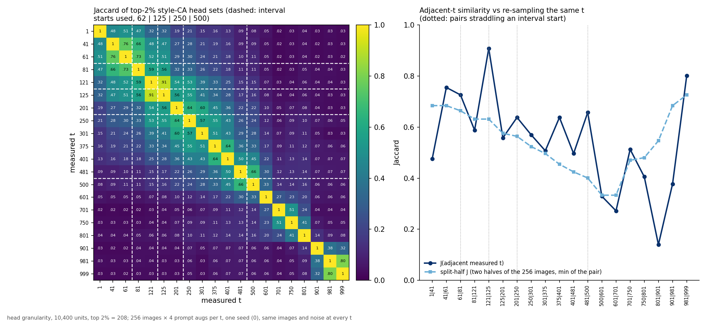
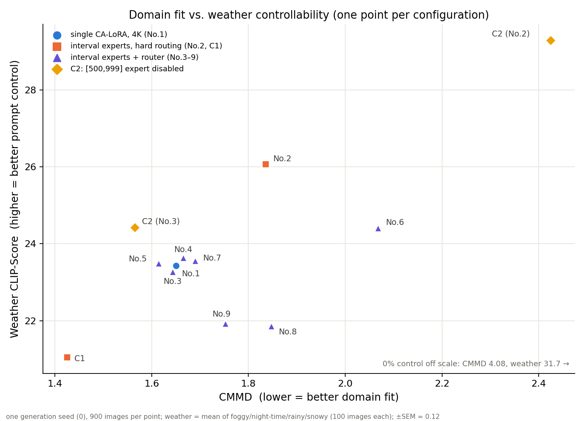
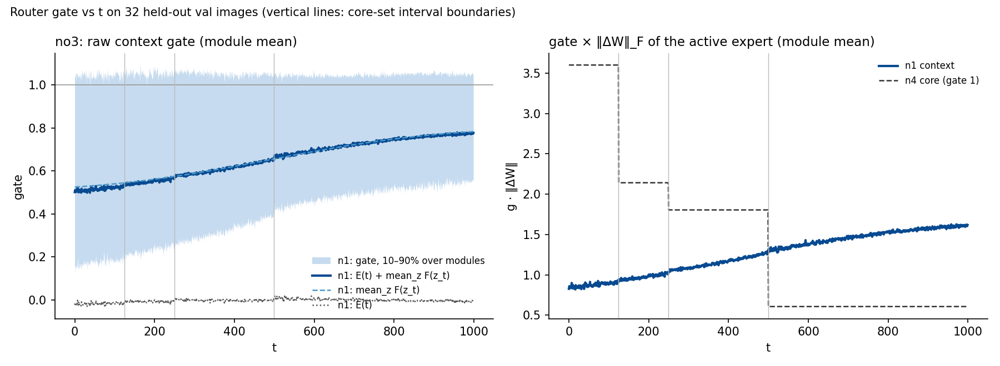

# 보고서 — CA-LoRA with TimeStep Master, 학습 이미지 10장 재실험 (SDXL + Cityscapes)

> 2026-11 재실험. `docs/Conclusion.md`(2026-09-21)와 `docs/RESULTS.md`(2026-09-19)를 바탕으로 새로 썼다. 결과 앞부분(문제 상황, novelty, 진단, 구성)은 두 문서의 내용을 그대로 옮겼고(구성표의 소요 시간만 이번 실행 값), 결과부터는 이번 재실험의 수치만 쓴다. 예외는 §5.7(전체 데이터 실험과의 비교)과 부록 A(선행 Improving CA-LoRA)이며 둘 다 그렇게 표시했다.
>
> **이번 실험이 앞선 실험과 다른 점**
> - 학습 데이터: Cityscapes train 2,975장 전체 대신 **무작위 10장**(`train.subset_size: 10`, `subset_seed: 0`, `runs/sdxl_cityscapes_fewshot10/training_subset.json`). 같은 seed라 Optimizing-CA-LoRA의 few-shot 캠페인과 같은 10장이다. 10장은 fostering과 라우터 학습에만 쓰인다. CA 측정과 선택 집합, 생성 프롬프트의 클래스 이름, CMMD reference(val 500장)는 앞선 실험과 같다.
> - 연산: A100 텐서코어 사용. 학습 forward는 bf16 autocast(가중치·LoRA·Adam 상태는 fp32), fp32 행렬곱은 TF32, gradient checkpointing 끔, random crop을 latent 공간에서 자르는 latent cache. 생성은 fp32 + TF32(bf16 생성은 형제 저장소의 사전 등록 기준 CLIP cosine 0.99에 못 미쳐 쓰지 않음). 평가(CLIP)는 앞선 실험과 같은 fp32.
> - 그 밖의 프로토콜(구간, 대표 *t*, expert당 4K step, 라우터 1K step·batch 8, 생성 seed 0, 구성당 900장)은 같다.
>
> 공통 조건: SDXL base + Cityscapes, style 축 CA, 상위 2%(10,400개 head 단위 중 208개), rank 64 sliced LoRA. 평가는 CMMD(정렬, 낮을수록 좋음)와 weather CLIP-Score(날씨 프롬프트 제어성, 높을수록 좋음), 구성당 900장(in_domain 500 + 날씨 4조건 × 100), guidance 5.0, 25 step, Euler, 1024 px, CLIP ViT-L/14, **생성 seed 1개**, mIoU 없음.

## 1. 문제 상황

CA-LoRA(Park et al., CVPR 2025)는 concept-awareness(CA = E[‖∇L_Concept‖ / ‖∇L_Diff‖])가 높은 상위 2% 어텐션 헤드에만 LoRA를 붙여, 타깃 도메인에 정렬하면서도 프롬프트 제어성(악천후 합성)을 지키려는 방법이다.

약점은 CA가 측정 timestep *t*의 함수인데 그 *t*가 하나이고, 논문이 {1, 81, 201, 481} 중 t = 81을 CA 분포의 시각적 비교로 골랐다는 점이다. *t*는 학습이 아니라 **선택**에 쓰이므로, 이 휴리스틱 하나가 어떤 파라미터가 학습되는지를 통째로 정한다. 공식 코드도 없었다.

두 실험은 이 문제를 서로 다른 방향에서 다뤘다.

| | 질문 | 접근 |
|---|---|---|
| Improving CA-LoRA | *t*를 **더 잘 고를 수 있는가** | 정량 점수로 *t*를 순위화 |
| CA-LoRA-TSM | *t* 결정이 **불완전해도 괜찮게** 만들 수 있는가 | 단일 *t* 의존을 없애고 noise 구간별로 선택 |

두 번째 질문은 첫 번째의 실패에서 나왔다. 다른 도메인이나 백본(특히 timestep 정의가 다른 flow matching 계열)으로 옮길 때마다 *t*를 다시 탐색해야 하는 부담을 없애는 것이 실용적 목표였다.

## 2. Novelty

**Improving CA-LoRA**

- CA-LoRA 전체 재구현(CA 측정, head 단위 선택, sliced LoRA, 평가 프로토콜).
- 방향 보존 *t* 기준: CA는 노름 비라 방향을 버린다. 헤드별 정규화 그래디언트 방향을 남겨 축 간 방향 유사도(ews)로 13개 *t*를 순위화.
- 여러 *t*의 CA를 집계한 선택(multi-timestep aggregation).
- 학습 중 CA 재측정으로 선택 집합이 유지되는지 추적(drift).
- 통제: 무작위 2%(E_random), 전체 어텐션(E_all).

**CA-LoRA-TSM**

- 가설: 어떤 헤드가 concept에 민감한지는 noise level에 따라 다르므로, 구간마다 LoRA **가중치**뿐 아니라 **선택 집합(붙는 위치)**도 달라야 한다. TSM은 가중치만 구간별로 나눈다.
- 구간별 CA 선택 + 비균등 구간 expert(위에서부터 절반 자르기, 저노이즈 쪽이 촘촘함. n1/n3/n4/n5, 대표 *t* 41/81/201/375/750) + TSM식 core-context 라우터. 선택 위치가 expert마다 달라 게이트는 projection 행렬별, 활성화 함수 없음, 항등 초기화.
- 선택 집합의 *t* 의존 진단: 20개 *t*의 쌍별 Jaccard와, 측정 잡음 기준선으로서의 split-half Jaccard.
- 효과의 출처를 분리하는 통제: **C1**(구간별 학습은 그대로, 선택만 t = 81로 고정)과 **C2**([500, 999] expert만 비활성).
- 보조 도구: batch 1 학습 loss가 신호가 아니어서, 고정된 (이미지, *t*, ε) 96개에서 base와 expert를 짝지은 L_Diff 비교.

## 3. 진단: 선택 집합의 *t* 의존성

이번 재실험은 CA를 다시 재지 않고 앞선 실험의 선택 집합을 그대로 쓴다(256장 측정). 아래는 그 측정의 진단이다.

- CA 측정 20개 *t*(head 단위, 256 샘플 × 4 aug, fp32, seed 0, 모든 *t*가 같은 이미지·노이즈). 상위 저장소 13개 재사용 + 7개 신규(61, 125, 250, 375, 500, 750, 999), *t*당 76분.
- **전제 검증.** top-2% 집합은 *t*에 따라 실제로 달라진다. 인접 *t*는 같은 *t*를 다시 잰 것만큼 비슷하지만(인접 19쌍 중 13쌍이 split-half 대비 ≥0.95), 거리에 따라 차이가 누적된다(81 대비 Jaccard: 121→0.59, 250→0.33, 500→0.11, ≥601→0.02~0.05). 뚜렷한 단절은 1|41(0.69)과 801|901|981(0.26, 0.55)뿐.
- **높은 *t*의 불안정.** t = 401~701의 split-half Jaccard 0.33~0.48, 즉 top 집합의 절반이 샘플링 잡음. [500, 999]는 단일 *t*로 대표되지 않는다(750 vs 981 J 0.05).
- **대표 *t* 결정(사용자, 시각적 휴리스틱, 점수 없음).** 경계는 절반 자르기 유지. n1 [81], n3 [81, 375, 750], n4 [81, 201, 375, 750], n5 [41, 81, 201, 375, 750]. 근거 전문 `runs/sdxl_cityscapes/diagnosis/DECISION.md`.

## 4. 구성

| No. | expert set | core | 라우터 | expert 수 | 명목 파라미터(2%/expert) | t당 활성 | fostering | assembling |
|---|---|---|---|---|---|---|---|---|
| 1 | n1 | n1 | 없음 | 1 | 2% | 2% | 15 min | 31 s |
| 2 | n4 | n4 | 없음(하드) | 4 | 8% | 2% | 4 × 15~17 min | 29 s |
| 3 | n1+n4 | n4 | 학습 | 5 | 10% | 4% | (공유) | 15.6 min |
| 4 | n1+n3+n4 | n4 | 학습 | 8 | 16% | 6% | (공유) | 17.4 min |
| 5 | n1+n4+n5 | n4 | 학습 | 10 | 20% | 6% | (공유) | 18.1 min |
| 6 | n3+n4+n5 | n4 | 학습 | 12 | 24% | 6% | (공유) | 19.5 min |
| 7 | n1+n4+n5 | n5 | 학습 | 10 | 20% | 6% | (공유) | 18.7 min |
| 8 | n1+n3+n4+n5 | n4 | 학습 | 13 | 26% | 8% | (공유) | 19.8 min |
| 9 | n1+n3+n4+n5 | n5 | 학습 | 13 | 26% | 8% | (공유) | 19.8 min |
| C1 | n4, 선택 t = 81 고정 | n4 | 없음 | 4 | 8% | 2% | 4 × 15~16 min | 30 s |
| C2-n2 | No.2 − n4_i3 | n4 | 없음 | 4(1 비활성) | 8% | 2% ([500,999] 0%) | — | 63 s |
| C2-n3 | No.3 − n4_i3 | n4 | 재학습 | 5(1 비활성) | 10% | 4% ([500,999] 2%) | — | 15.6 min |

- "2%"는 head 단위 10,400개 중 208개. expert 파일 31 MB(fp32, rank 64) ≈ 7.7M 파라미터, SDXL UNet(2.6B)의 약 0.3%.
- fostering은 12회(n 계열 고유 8개 + C1 4개) × 4K step, 총 3.1 h. 이번에는 n1_i0도 10장으로 새로 학습했다. 명목 13개 expert 중 5개는 동일 구성 공유(같은 구간, 같은 선택 sha, 같은 seed. `scripts/share_expert.py`로 복사해 비트 단위로 같음을 확인).
- 라우터: FC(mean z_t) + E(t), 모듈별 raw 게이트(활성화 없음, 초기값 1.0), 1000 step, batch 8, lr 1e-3. 라우터당 15.6~19.8 min.
- 학습 데이터는 무작위 10장(위 머리말)이다. 매 step 그중 한 장에서 1024 px 창을 무작위로 잘라 쓴다. paired loss(§5.4)는 비교를 위해 앞선 실험과 같은 전체 train 96개 draw로 쟀다(base L_Diff가 일곱 구간 모두 앞선 실험과 일치).

## 5. 결과

정량 원표 전체(오차, 통제 대조, 진단, 라우터, paired loss)는 `docs/QUANTITATIVE_fewshot10.md`(`scripts/make_quantitative.py`가 원본 JSON에서 생성), 집계표와 그림은 `results/fewshot10/`, `figures/fewshot10/`(`scripts/make_results.py`).

### 5.1 주 결과

base SDXL(0%)은 Optimizing-CA-LoRA few-shot 캠페인의 `control_base/eval.json`을 재사용했다. 학습이 없어 10장 여부와 무관하고, eval.json의 프로토콜 블록이 이번 실험과 같다(그쪽에만 있는 `generation_autocast: no` 항목은 이번 생성도 autocast 없는 fp32라 같은 조건).

| 구성 | CMMD ↓ | in-domain CLIP | weather CLIP ↑ | foggy | night | rainy | snowy |
|---|---|---|---|---|---|---|---|
| base SDXL (0%) | 4.075 | 28.81 | 31.68 | 32.87 | 30.26 | 32.02 | 31.55 |
| **No.1** n1 (t = 81, 4K) | 1.650 | 22.62 | 23.43 | 25.89 | 20.86 | 23.52 | 23.44 |
| **No.2** n4 하드 | 1.835 | 23.86 | **26.07** | 27.48 | 24.88 | 25.77 | 26.14 |
| No.3 n1+n4 | 1.644 | 21.45 | 23.28 | 24.99 | 21.71 | 22.85 | 23.58 |
| No.4 n1+n3+n4 | 1.665 | 22.08 | 23.64 | 25.43 | 21.81 | 23.84 | 23.47 |
| No.5 n1+n4+n5 | 1.614 | 21.89 | 23.50 | 25.30 | 21.44 | 23.70 | 23.54 |
| No.6 n3+n4+n5 | 2.068 | 22.86 | 24.41 | 26.43 | 21.78 | 24.99 | 24.46 |
| No.7 n1+n4+n5, core n5 | 1.690 | 22.14 | 23.56 | 25.21 | 21.65 | 23.81 | 23.57 |
| No.8 n1+n3+n4+n5 | 1.847 | 21.71 | 21.87 | 24.21 | 20.10 | 22.03 | 21.13 |
| No.9 n1+n3+n4+n5, core n5 | 1.752 | 21.71 | 21.93 | 24.14 | 20.17 | 21.82 | 21.60 |
| **C1** n4, 선택 t = 81 고정 | **1.425** | 21.78 | 21.04 | 24.39 | 18.19 | 21.35 | 20.24 |
| C2-n2 (No.2 − n4_i3) | 2.424 | 27.01 | 29.30 | 30.71 | 27.77 | 29.44 | 29.28 |
| C2-n3 (No.3 − n4_i3) | 1.565 | 23.46 | 24.43 | 26.42 | 22.40 | 23.96 | 24.93 |

weather CLIP의 표본 오차(SEM, 한 seed 안 프롬프트 간)는 0.10~0.15. CMMD는 집합 통계라 오차 추정이 없다. 두 축의 Pareto 비지배 구성은 **C1, C2-n3, No.2, C2-n2** 넷이다.

### 5.2 읽은 것

1. **선택 집합의 효과는 여전히 트레이드오프의 위치 이동이다 (No.2 vs C1).** 구간, step, seed가 같고 선택 집합만 다르다. 구간별 선택은 weather를 +5.03점 올리고(z 32.5) CMMD를 28.8% 악화시킨다(1.425 → 1.835). 방향은 그대로이고, 정렬 쪽 대가는 앞선 실험보다 작다(§5.7).
2. **구간별 학습(TSM) 쪽 차이 (C1 vs No.1).** 선택은 같고(t = 81) 총 학습량이 다르다(C1 4 × 4K = 16K, No.1 4K). C1이 CMMD −13.6%(1.425 vs 1.650), weather −2.38점(z −13.2). 10장으로 학습하므로 16K step은 이미지당 약 1,600회, 4K는 약 400회 노출이다. 구간별 학습의 효과와 학습량(곧 10장에 대한 노출 횟수)의 효과는 여기서도 분리되지 않는다.
3. **결과의 위치를 정하는 것은 [500, 999] expert다 (C2). 다만 라우터 구성에서는 그 expert가 두 축 모두에서 손해였다.**
   - 하드 라우팅(No.2)에서 n4_i3만 끄면 weather가 26.07 → 29.30(+3.23, z 22.9, base 31.68)으로 올라가고 CMMD는 1.835 → 2.424(+32%)가 된다. base 대비 잃은 제어성의 58%가 이 expert 하나의 몫이다. 생성 이미지도 base와 거의 같은 구도와 색으로 돌아간다(§5.5).
   - 라우터 구성(No.3)에서 n4_i3를 끄고 그 구간을 n1_i0(t = 81 선택)에게 맡기면(C2-n3) CMMD 1.644 → 1.565(−4.8%), weather 23.28 → 24.43(+1.14, z 6.7)으로 **두 축이 함께 좋아진다.** C2-n3는 No.1(1.650 / 23.43)과 라우터 구성 No.3~9 전부를 두 축 모두에서 앞선다(No.1 대비 CMMD −5.2%, weather +1.00, z 약 5.3).
   - 이 이득이 라우터 덕인지, [500, 999]에 t = 81 선택을 쓰고 저노이즈 구간에만 구간별 선택을 쓴 조합 덕인지는 분리되지 않는다. 같은 조합의 하드 라우팅 대조가 없다.
4. **Assembling(라우터)은 이득이 없다. 다만 앞선 실험처럼 No.1보다 나쁘지도 않다.** n1을 포함한 3-set 이하 라우터(No.3, 4, 5, 7)는 CMMD 1.614~1.690, weather 23.28~23.64로 No.1(1.650 / 23.43) 주위에 모여 있다. No.1과의 weather 차이는 z 1.2 이하이고, CMMD 차이는 ±2.5% 안이다. set을 4개로 늘리면(No.8, 9) 두 축 모두 나빠진다(CMMD 1.75~1.85, weather 21.9). n1이 없는 No.6은 제어성이 No.2 쪽으로 가지만(24.41) 두 지표 모두 No.2에 진다. No.6, 8, 9는 일부 이미지가 텍스처 패턴으로 무너진다(§5.5). 10장 학습에서 set을 많이 섞으면 생기는 결함으로 보인다.
5. **core 선택은 일관된 효과가 없다.** weather는 같고(No.7 − No.5, No.9 − No.8 모두 +0.06, z 0.3), CMMD는 3-set에서 +4.7%, 4-set에서 −5.1%로 방향이 엇갈린다. 앞선 실험에서는 소수 둘째 자리까지 같았다.
6. **n1 제외 (No.6 vs No.8).** n1을 빼면 weather +2.55점(z 12.7), CMMD +12.0%. t = 81 전 구간 expert가 정렬 쪽, 세분 set이 제어성 쪽이라는 방향은 앞선 실험과 같다.
7. **step 수.** 이번 재실험에는 10K step 단일 LoRA 기준이 없어 따로 판단하지 않는다. 같은 축 위에 있다는 간접 근거는 2번(C1 vs No.1)뿐이다.

### 5.3 라우터 분석

- 8개 라우터 전부 음수 게이트가 없다. context set은 전역 0.80~0.95배로 억제되고, 모듈별로는 0.05~1.58 사이에 재배분된다. n1(전 구간)이 가장 덜 억제되고 세분 set(n3, n5)은 더 억제된다(예: No.8에서 n1 0.95, n3 0.88, n5 0.86).
- **E(t)는 거의 학습되지 않았다.** E(t) 최대 절대값은 0.115~0.135이다. 라텐트 항을 뺀 게이트 g0 = bias + E(t)의 core 구간별 평균 차이는 set마다 0.02 이하다(C2-n3 제외). 라텐트 항 ‖fc.W‖_F는 3.9~8.1이다.
- **그래도 실제 게이트는 t를 따라 움직인다 (No.3, 아래 그림).** val 32장에 모든 t의 노이즈를 입혀 라우터를 돌린 결과다(`scripts/router_gate_vs_t.py`, `results/fewshot10/router_gate/no3.json`).
  - E(t)의 모듈 평균은 −0.03~+0.02로 거의 0이다.
  - 게이트 E(t) + mean_z F(z_t)는 t = 0의 0.50에서 t = 999의 0.78로 꾸준히 오른다. z_t의 채널 평균이 √ᾱ_t를 따라 줄어서, 라텐트 항 F(z_t)를 거쳐 t 의존이 생기기 때문이다.
  - 이미지 간 차이는 작다(F의 표준편차 t = 0에서 0.05, t ≥ 750에서 0.012 이하).
  - 앞선 실험의 RESULTS.md §4는 이 분석 전이라 "이미지 내용에 따라 섞는다"고 썼지만, 실제 t 의존의 경로는 라텐트 통계다.

| core 구간 | [0, 124] | [125, 249] | [250, 499] | [500, 999] |
|---|---:|---:|---:|---:|
| n1 context 게이트 E(t) + mean_z F(z_t) | 0.517 | 0.550 | 0.611 | 0.730 |
| n1 context, g · ‖ΔW‖ | 0.877 | 0.974 | 1.152 | 1.480 |
| n4 core, ‖ΔW‖ (게이트 1) | 3.600 | 2.142 | 1.805 | 0.608 |

- [500, 999]에서는 전 구간 expert n1이 그 구간의 core expert n4_i3보다 가중치 기준으로 2.4배 크게 기여한다. 앞선 실험(1.30 vs 0.55, 역시 2.4배)과 같은 모양이다. 이번에는 저노이즈 구간 n4 expert의 ‖ΔW‖가 앞선 실험(2.30)보다 크다(3.60).
- 이것은 C2-n3의 결과와 맞는다. No.3에서도 고노이즈 구간은 이미 n1이 주도했고, 작게 섞인 n4_i3(t = 750 선택)를 마저 빼자 두 축이 함께 좋아졌다.
- ‖ΔW‖_F는 기여의 가중치 프록시이지 측정한 활성이 아니다. 분석한 라우터는 하나다.

- C2-n3 라우터는 n4 expert가 없는 [500, 999]에서 n1을 덜 억제했다(g0 0.868, 다른 구간은 0.838~0.853). 방향은 앞선 실험과 같다.
- 라우터 학습 loss는 batch마다의 (이미지, t) 추첨이 지배해 비교 신호가 아니다(loss@1000이 8개 모두 0.137). 학습 여부는 게이트 통계(`bundles/*/bundle_stats.json`의 `bias_moved`, 8개 모두 true)로 확인했다.

### 5.4 paired loss (L_Diff)

앞선 실험과 같은 96개 (이미지, t, 노이즈)를 전체 train에서 뽑아 base 대비 짝지은 차이를 쟀다. 학습한 10장이 아닌 이미지가 대부분이므로, 10장 학습이 Cityscapes 전체로 얼마나 일반화되는지를 본다.

| 구간 | base L_Diff | 구간 expert | n1_i0 (그 구간만) | C1 (t = 81 선택) |
|---|---|---|---|---|
| [0,61] | 0.26942 | n5_i0 −0.19% | −0.22% | — |
| [62,124] | 0.32500 | n5_i1 −0.29% | −0.29% | — |
| [0,124] | 0.31036 | n4_i0 −0.24% | −0.27% | −0.26% |
| [125,249] | 0.28685 | n4_i1 −0.50% | −0.54% | −0.53% |
| [0,249] | 0.30191 | n3_i0 −0.39% | −0.36% | — |
| [250,499] | 0.15621 | n4_i2 −1.07% | −1.23% | −1.18% |
| [500,999] | 0.02236 | n4_i3 −4.38% | −5.01% | −5.03% |

SEM은 상대 변화로 0.01~0.25%p(`docs/QUANTITATIVE_fewshot10.md` §4).

- t = 81 선택(n1_i0, C1)이 일곱 구간 중 여섯에서 구간별 선택 expert보다 L_Diff를 같거나 더 낮춘다. 예외는 [0, 249]의 n3_i0(−0.39% vs −0.36%)뿐이다. C1은 n4의 네 구간 모두에서 구간별 선택보다 낮다.
- L_Diff는 정렬 축과 같은 방향이며 C1의 CMMD 우위와 맞는다.
- 앞선 실험에서는 낮은 구간에서 구간 학습이 이겼지만(예: [0,124] −0.56% vs n1_i0 −0.37%), 10장에서는 그 우위가 사라졌다. 저노이즈 구간의 개선 폭 자체도 절반 이하로 줄었다([0,124] 구간 expert −0.24%).

### 5.5 정성 (가벼운 점검)

같은 index(같은 프롬프트, 노이즈)를 arm 간 나란히 본 비교다. in_domain 3장(0, 7, 123), 날씨 조건별 1장(500, 600, 700, 800), No.6의 in_domain 40장을 봤다. 앞선 실험의 `docs/QUALITATIVE_2026-09-19.md`만큼 체계적인 평가는 아니다.

- **t = 81 선택이 들어간 구성(No.1, C1, No.3, C2-n3)**: Cityscapes의 강한 녹색 캐스트와 노출, 촬영 차량 보닛과 엠블럼을 흉내 낸다. 날씨 프롬프트는 약하게만 반영된다. night-time이 회색 낮으로 나오고(No.1, C1, C2-n3), 안개는 옅다. 앞선 실험의 A 묶음과 같다.
- **No.2**: 앞선 실험과 달리 in_domain에서도 녹색 캐스트를 띠고 엠블럼도 보인다. 즉 10장에서는 구간별 선택도 look을 흡수한다. 그래도 짙은 안개, 가로등이 켜진 황혼, 젖은 노면, 눈은 실제로 만든다. 앞선 실험의 "구간별 선택은 구조만 배우고 look은 남긴다"는 이번에는 성립하지 않고, 차이는 날씨를 그리는 능력에 남는다.
- **C2-n2**: base와 거의 같은 구도와 색이다. [500, 999]의 expert가 빠지면 장면 배치는 base 그대로이고, 저노이즈 expert는 세부만 바꾼다.
- **No.6, 8, 9 (n3와 n5를 context로 함께 쓰는 라우터)**: 일부 이미지가 장면 대신 반복 텍스처 패턴으로 무너진다.
  - No.6은 in_domain 표본 40장 중 4장(index 0, 144, 156, 384)이 이렇다.
  - 고주파 에너지 상위 7장을 보면 No.6은 7장, No.8과 No.9는 각각 6장이 무너진 이미지다(index 0, 210, 211, 318, 384, 453 등이 두 구성에서 겹친다).
  - No.4(n1+n3+n4)는 index 0 한 장뿐이다.
  - 고주파 점수는 극단적인 경우만 잡으므로 정확한 빈도는 재지 않았다. No.6은 표본으로 보아 10% 안팎이다.
  - 이 붕괴는 세 구성의 CMMD가 라우터군에서 높은 쪽(1.75~2.07)인 것, No.8과 9의 weather가 낮은 것과 맞는다. 앞선 실험에서 No.6의 결함은 모션 블러였다.

### 5.6 design §5.2 시나리오 판정과 주장에 대한 결론

- **시나리오 1("No.1 최고, 높은 구간 불필요/유해")**: 부분 해당. No.1은 정렬 축에서 No.2를 이기지만 C1과 C2-n3에 진다. 높은 구간의 구간별 expert(t = 750 선택)는 하드 라우팅에서는 결과를 지배하고(C2-n2), 라우터 구성에서는 두 축 모두에서 손해였다(C2-n3 vs No.3).
- **시나리오 2("Assembling 효과 미미")**: **해당.** 라우터 구성 No.3~9는 No.1과 구분되지 않거나(No.3, 4, 5, 7) 더 나빴다(No.6, 8, 9). 하드 라우팅이나 단일 LoRA를 넘은 라우터 구성은 C2-n3 하나이고, 그 이득은 라우터와 분리되지 않는다(§5.2의 3번).
- **시나리오 7("C1 ≈ 최고 → 2절 주장 기각")**: **해당.** C1은 1차 지표인 CMMD에서 전 구성 최고다(1.425, 다음은 C2-n3 1.565). 구간별 선택(No.2 vs C1)은 제어성을 5.0점 올리지만 CMMD를 29% 악화시켜 "더 나은 성능"이 아니라 위치 이동이다. 단 C1 vs No.1 차이는 총 학습량과 섞여 있다.
- **2절 주장("t마다 선택 집합도 달라야 한다")에 대한 결론: 기각.** 10장 학습에서도 여러 t 구간의 선택을 나눠 쓰는 것은 개선이 아니었다. 정렬은 t = 81 선택이 가장 좋았다. 다만 저노이즈 구간에만 구간별 선택을 쓰고 [500, 999]는 t = 81 선택에 맡긴 C2-n3가 No.1을 두 축 모두에서 소폭 앞섰다. 이것은 주장을 살리는 근거가 아니다. 오히려 고노이즈 구간에는 구간별 선택을 쓰지 말라는 쪽이다. "t 결정이 불완전해도 괜찮은 학습법"이라는 원 목표는 달성되지 않았고, 이를 직접 시험하는 강건성 sweep은 실시하지 않았다.

### 5.7 참고: 전체 데이터 실험과의 비교 (교란 있음)

같은 구성의 앞선 실험(train 2,975장, fp32, 2026-09) 수치를 나란히 둔다. 두 실험 사이에는 데이터 수 외에도 아래 교란이 함께 바뀌었으므로, 차이를 10장의 효과로만 읽을 수 없다.

| 구성 | CMMD 전체 → 10장 | weather 전체 → 10장 |
|---|---|---|
| base SDXL | 4.078 → 4.075 | 31.68 → 31.68 |
| No.1 | 1.133 → 1.650 (+46%) | 23.07 → 23.43 |
| No.2 | 1.514 → 1.835 (+21%) | 26.71 → 26.07 |
| 라우터 No.3, 4, 5, 7 | 1.46~1.50 → 1.61~1.69 | 23.1~23.4 → 23.3~23.6 |
| 라우터 No.8, 9 | 1.55~1.58 → 1.75~1.85 | 22.8~23.0 → 21.9 |
| No.6 | 1.832 → 2.068 (+13%) | 25.67 → 24.41 |
| C1 | 0.966 → 1.425 (+48%) | 21.59 → 21.04 |
| C2-n2 | 2.459 → 2.424 (−1%) | 29.95 → 29.30 |
| C2-n3 | 1.129 → 1.565 (+39%) | 23.60 → 24.43 |

- **정렬은 나빠지고 제어성은 유지됐다.** 학습된 구성의 CMMD는 9~48% 올랐다(라우터군 9~17%, No.1, C1, C2-n3는 39~48%). weather는 12개 중 9개가 ±0.85점 안에서 움직였고, No.6, 8, 9만 1.0~1.3점 내려갔다. 10장으로는 Cityscapes val 500장의 분포를 덜 덮는다는 해석과 맞다. C2-n2만 CMMD가 그대로인 것은 그 구성이 [500, 999]를 base에 맡겨 원래 정렬을 적게 하기 때문이다.
- **유지된 결론**: C1이 정렬 최고, No.2와 C2-n2가 제어성 쪽, No.2 vs C1의 위치 이동, [500, 999] expert가 손잡이, 라우터 무이득, E(t)가 거의 학습되지 않고 게이트의 t 의존은 라텐트 항을 거쳐 생기는 것, 고노이즈 구간에서 n1이 core expert보다 크게 기여하는 것.
- **바뀐 것**:
  - 라우터군이 No.1보다 나쁜 자리에서 No.1과 같은 자리로 왔다.
  - No.2 vs C1의 CMMD 격차가 57%에서 29%로 줄었다.
  - 낮은 구간에서 구간 expert가 보이던 paired loss 우위가 사라졌다.
  - C2-n3의 No.1 대비 우위가 커졌다(앞선 실험 CMMD −0.4%, weather +0.53 → 이번 −5.2%, +1.00).
  - No.2도 Cityscapes look을 흡수했다.
- **교란**:
  1. 학습 데이터 2,975장 → 10장.
  2. 학습 forward fp32 → bf16 autocast(가중치, LoRA, Adam은 fp32).
  3. 매 step 픽셀 crop 후 VAE encode → 원본 프레임 latent를 한 번 캐시하고 latent 공간에서 crop.
  4. 학습과 생성의 fp32 행렬곱에 TF32.
  5. n1_i0를 상위 저장소 10K run의 step-4000 체크포인트에서 import → 이번 설정으로 새로 학습.
  6. base control이 다른 세션에서 다시 생성됨(4.078 → 4.075).

  gradient checkpointing을 끈 것은 수치에 영향이 없다.

## 6. 결론 및 요약

**한 문장.** 10장으로 학습해도 구간별 선택, 구간별 학습, 라우터, 다중 set은 정렬과 제어성 사이의 트레이드오프 위에서 위치만 옮겼다. 예외는 고노이즈 구간의 구간별 expert를 뺀 C2-n3 하나로, No.1을 두 축 모두에서 소폭 앞섰다(생성 seed 1개, CMMD 오차 미측정).

- ***t*를 잘 고르는 방법은 찾지 못했다(선행, 부록 A).** 정량 점수는 학습 결과를 예측하지 못했다. 이번 재실험에서도 정렬 기준으로는 논문의 휴리스틱 t = 81이 가장 좋았다(C1, No.1, 그리고 [500, 999]를 t = 81에 맡긴 C2-n3).
- **핵심 주장은 기각된다.** 선택 집합이 noise level에 따라 달라지는 것은 맞다(§3 진단). 그러나 여러 *t* 구간의 선택을 나눠 쓰는 것은 결과를 개선하지 못하고, 정렬을 내주고 제어성을 얻는 쪽으로 위치만 옮긴다(No.2 vs C1). 10장 학습에서도 같다.
- **고노이즈 구간이 손잡이다.** [500, 999]에 t = 750 선택 expert를 쓰면 하드 라우팅에서는 제어성의 대부분을 잃고(C2-n2), 라우터 구성에서는 두 축 모두 손해였다(C2-n3). 여러 *t*의 정보를 쓰는 이득이 있다면 저노이즈 구간에 한정된다. 이것은 가설이고, 라우터 없는 같은 조합의 대조로 확인해야 한다.
- **"*t* 결정이 불완전해도 괜찮은 방법"이라는 원 목표는 달성되지 않았다.** 라우터로 여러 선택을 섞는 것은 효과가 없었다. 목표를 직접 시험하는 강건성 sweep(최저 구간 *t*를 바꿔 재학습)은 실시하지 않았다.
- **실용 규칙.**
  - 결과를 움직이는 손잡이는 (i) 고노이즈 구간 [500, 999]에 어떤 선택 집합을 쓰는가, (ii) 학습량 두 가지다.
  - 정렬이 필요하면 C1(t = 81 선택 + 구간별 학습), 제어성이 필요하면 No.2(구간별 선택 + 하드 라우팅)를 쓴다. 이번 수치로는 C2-n3가 둘 사이의 균형점이다.
  - 라우터와 다중 set은 텐서코어를 쓰면 라우터당 15~20분으로 싸졌지만, 파라미터(최대 26%)에 비해 얻는 것이 없다.
- **10장이면 정렬이 덜 되고 제어성은 남는다.** 같은 구성의 CMMD가 전체 데이터 대비 9~48% 높고, weather CLIP은 대부분 거의 같다. 구성 간 순서와 결론은 대부분 유지됐다(§5.7, 교란 있음).
- **CA 선택 자체에 대한 의문이 남는다(선행, 부록 A).** 무작위 2%가 style-CA 선택과 비슷한 정렬에 더 높은 제어성을 보였고, 선택된 헤드는 500 step 안에 상위 2%에서 밀려난다.

**한계.**
- 모든 수치는 생성 seed 1개이며 seed 간 분산을 재지 않았다. 라우터군 내부 차이(CMMD 1.61~1.69)와 C2-n3 vs No.1의 CMMD 차이(−5%)는 잡음 안일 수 있다. No.2 vs C1, C2-n2 같은 큰 대조는 CLIP 표본오차 기준 z가 20 이상이다.
- 10장은 한 번만 뽑았다(seed 0). 다른 10장에서 같은 결과가 나오는지 모른다.
- 선택 집합과 대표 *t*는 전체 데이터 256장으로 잰 CA에서 왔다. 이 실험은 "전체 데이터로 고른 위치에 10장으로 학습"이지, CA 측정까지 10장으로 하는 완전한 few-shot 파이프라인이 아니다.
- mIoU가 없어, 트레이드오프 위의 어느 위치가 실제 세그멘테이션 데이터로 더 좋은지는 판정하지 못했다.
- 백본, 데이터셋, 축(style)이 각각 하나다.
- 앞선 실험과의 비교에는 §5.7의 교란이 있다.

**다음 실험 후보.**
- (a) C2-n3의 하드 라우팅 대조: 저노이즈 구간 n4_i0~i2 + [500, 999]에 n1_i0. 라우터 없이 생성 1개, 약 1.5 h. 이번 결과에서 정보량이 가장 크다.
- (b) [500, 999] 구간의 선택만 바꿔 보기: t = 500/999, 집계 선택, 무작위 선택. 각각 fostering 1개 + 생성 1개, 약 2 h.
- (c) seed 1개 추가: No.1, No.3, C2-n3, 약 4.5 h.
- (d) 다른 10장 draw로 No.1, No.2, C1, C2-n3 재실행.

## 7. 실행 로그와 프로토콜 이탈

| 단계 | 실제 소요 | 비고 |
|---|---|---|
| 텐서코어 게이트 | 4 min | 아래 표 |
| fostering | 12회 × 15.1~16.8 min ≈ 3.1 h | batch 1, 0.22~0.25 s/step, 최대 VRAM 21.7 GB(게이트) |
| expert 공유 | 0.6 min | 5개, 비트 단위로 같음 |
| assembling | 하드 4개 각 1.1 min 이하, 라우터 8개 × 15.6~19.8 min ≈ 2.4 h | batch 8, 0.90~1.09 s/step, 최대 VRAM 68.9 GB(No.9 게이트) |
| paired loss | 23 min | 19개 측정 |
| 생성·평가 | 12 arm × (85.5~95.1 min + 3 min) ≈ 18.7 h | 약 6.0 s/장(라우터 arm이 조금 느림), VRAM 44 GB |
| 합계 | 24 h 43 min (11/04 05:37 ~ 11/05 06:20 KST) | HALT, 재시도, OOM, NaN 없음 |

**텐서코어 게이트** (`scripts/ops/check_tensor_cores.py`, `runs/sdxl_cityscapes_fewshot10_gate/tensor_core_gate.json`). 방식은 Hierarchial-CFG의 `gpu_check.py`와 같다. profiler로 GEMM, conv, attention 커널 시간을 재고, 그중 텐서코어 커널의 몫을 본다.

| 항목 | 결과 | 기준 |
|---|---|---|
| 텐서코어 커널 비중 (fostering 실제 step) | 1.00 | ≥ 0.8 |
| fostering 속도 | 0.23 s/step (앞선 실험 1.08) | ≤ 0.6 |
| 라우터 No.9 (batch 8, GC 끔) | 1.15 s/step, 최대 68.9 GB (앞선 실험 7.6~8.4 s/step) | 70 GB 넘으면 GC 켬 |
| 생성 | 약 6 s/장 (앞선 실험 15.5) | — |
| UNet, VAE, LoRA 가중치 dtype | fp32 | fp32 |
| TF32 (matmul, cudnn) | 켜짐 | 켜짐 |
| 학습 10장 | 형제 캠페인과 같음 | 같음 |

**이탈(리포트에 명시).**
1. 명목 13 expert 중 8개만 학습(동일 구성 공유).
2. n1_i0는 이번에 새로 학습(앞선 실험은 import).
3. C1 n4_i0는 n4_i0와 동일 구성 재실행.
4. mIoU 미진행.
5. 라우터 batch 8.
6. 생성 seed 1개(분산 미측정).
7. base 대조군은 형제 캠페인 결과 재사용(프로토콜 일치 확인).
8. 라우터 No.3~9 전부 학습.
9. CA 측정과 선택 집합은 10장으로 다시 재지 않고 전체 데이터 실험의 것을 재사용(selection sha 대조).
10. 학습 정밀도와 crop 방식 변경(§5.7의 교란 2~4).
11. 평가(CLIP)는 앞선 실험, base 대조군과 맞추려고 TF32 없이 fp32.

**사고.**
- 게이트의 생성 속도 파싱 오류: 2장짜리 batch의 진행 막대를 4로 나눠 2.8 s/장으로 기록했다. ETA 계산에만 쓰이는 값이라 로그로 다시 계산했고, 측정 코드를 고쳤다(b418611).
- `scripts/make_results.py`가 상대 경로 출력 폴더에서 MANIFEST 작성 중 실패해 고쳤다. 기존 출력은 그대로다.
- 그 밖에 실행 중 사고는 없었다.

## 부록 A. 선행 결과: Improving CA-LoRA (전체 데이터, 10K step, 단일 LoRA, 이번 재실험 대상 아님)

`docs/Conclusion.md` §3.1을 그대로 옮긴다. 이번 재실험은 이 수치를 다시 만들지 않았고, §6에서 "선행"으로 표시한 문장의 근거다.

| arm (style 축) | CMMD ↓ | weather CLIP ↑ |
|---|---|---|
| A: t = 81 (논문) | **0.638** | 21.00 |
| B: top-3 집계 | 0.711 | 20.69 |
| C: t = 41 (점수 1위) | 0.751 | **23.16** |
| D: t = 1 (점수 2위) | 0.752 | 19.96 |
| E_random (무작위 2%) | 0.681 | 23.76 |
| E_all (전체 어텐션) | 0.596 | 20.65 |
| base SDXL | 4.078 | 31.68 |

- 재현은 성공했다. 네 arm 쌍 모두에서 style은 정렬, viewpoint는 제어성에서 앞선다(논문 Figure 6의 대비).
- **정량 점수로 고른 *t*는 이기지 못했다.** 1위 t = 41은 CMMD에서 t = 81에 지고 제어성에서만 앞선다. 2위 t = 1은 두 지표 모두에서 지배당한다.
- 무작위 2%가 CMMD 0.681로 CA arm 8개 중 6개보다 좋고, weather 23.76은 style arm 전부보다 높다. E_all은 논문의 전제(전체 파인튜닝은 정렬 최고, 제어성 붕괴)를 재현한다.
- 선택은 자기 학습을 견디지 못한다. 8개 run 전부에서 선택된 헤드가 약 500 step 안에 CA 상위 2% 밖으로 밀려나 돌아오지 않는다(Jaccard 0.07~0.16). 전체 CA 순위는 유지된다(Spearman 0.77~0.95).
- 서로 다른 noise level의 *t*는 상당히 다른 헤드 집합을 고른다. 이것이 두 번째 실험의 출발점이다.
