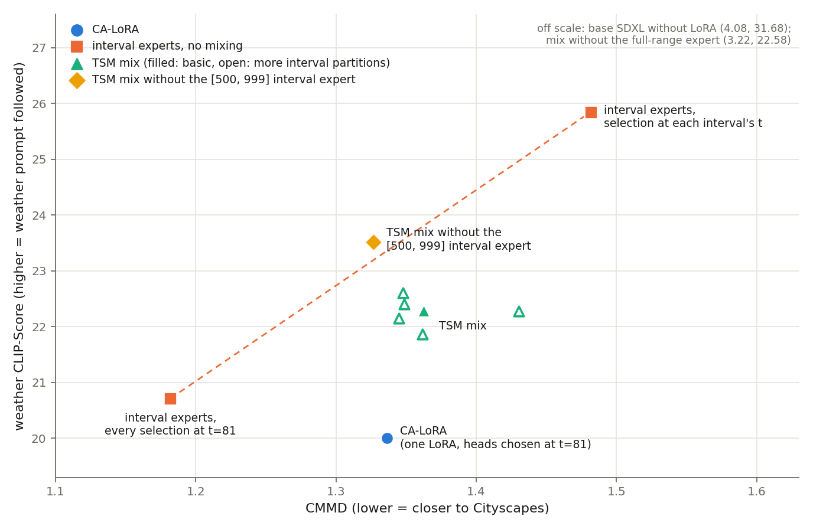

# CA-LoRA의 $t$ 민감성과 TSM 혼합 (SDXL, Cityscapes)

## 1. $t$에 민감한 어답터

CA-LoRA(Park et al., CVPR 2025)는 text-to-image diffusion 모델을 타깃 도메인에 맞추면서, 프롬프트로 장면을 바꾸는 능력은 남기려는 어답터다. 모델 전체를 미세조정하면 생성 이미지는 타깃 도메인에 가까워지지만 "안개 낀", "밤" 같은 프롬프트를 따르지 않게 된다. CA-LoRA는 attention head마다 concept-awareness(CA)를 재고, CA가 높은 상위 2% head에만 LoRA를 붙인다.

$$\mathrm{CA}(t) = \mathbb{E}\left[\frac{\lVert \nabla L_{\text{Concept}} \rVert}{\lVert \nabla L_{\text{Diff}} \rVert}\right]$$

$L_{\text{Concept}}$은 concept(이 보고서에서는 도메인의 style)에 대한 loss이고 $L_{\text{Diff}}$는 diffusion loss다. 두 gradient는 timestep $t$만큼 noise를 입힌 입력에서 head의 가중치에 대해 계산한다.

CA는 $t$의 함수인데 CA-LoRA는 $t$ 하나에서 잰 값으로 head를 정한다. 논문은 $t = 81$을 쓰며, 이 값은 $t$ 몇 개의 CA 분포를 눈으로 비교해 고른 것이다.

$t$를 바꾸면 선택되는 head가 바뀐다. SDXL에서 20개 $t$로 CA를 재고, $t$마다 상위 2% head 집합(10,400개 중 208개)을 구해 비교했다. $t = 81$의 집합과의 Jaccard 유사도는 $t = 201$에서 0.75, $t = 375$에서 0.49, $t = 500$에서 0.20, $t = 750$에서 0.04다. $t = 81$에서 표본을 절반씩 나눠 따로 잰 두 집합의 유사도가 0.88이므로, 이 차이는 측정 오차보다 크다.

선택이 바뀌면 학습 결과도 바뀐다. 결과는 두 지표로 본다. CMMD는 생성 이미지와 Cityscapes 이미지의 분포 거리이고 낮을수록 도메인에 가깝다. weather CLIP-Score는 날씨 프롬프트(안개, 밤, 비, 눈)로 생성한 이미지와 그 프롬프트의 CLIP 유사도이고 높을수록 프롬프트를 따른다. 같은 학습 이미지 10장으로 LoRA 하나를 학습하면, $t = 81$로 고른 head에서는 CMMD 1.421, weather CLIP-Score 21.43이 나오고 $t = 201$로 고른 head에서는 CMMD 1.584, weather CLIP-Score 19.13이 나온다. Jaccard가 0.75인 두 선택 사이에서 두 지표가 모두 달라진다. 이 두 LoRA는 3절의 실험보다 길게 학습한 것이어서 3절의 숫자와 직접 비교되지 않는다.

$t$ 하나가 모든 noise 수준에 맞는 head를 고른다는 근거는 없다. 모델이나 데이터가 바뀌면 그 $t$를 다시 찾아야 한다. 그래서 $t$ 하나에 의존하지 않고, noise 구간마다 그 구간의 $t$로 head를 고르는 방식을 시험했다.

## 2. TSM 혼합 방식

noise 구간마다 그 구간의 $t$에서 잰 CA로 head를 따로 고르고, 구간별로 학습한 LoRA를 TimeStep Master(TSM)의 방식으로 섞는다. CA-LoRA에서는 $t$ 하나가 모든 denoising step의 LoRA 위치를 정한다. 이 방식에서는 각 step이 자기 noise 수준에서 고른 위치의 LoRA를 쓴다.

TSM은 timestep 범위를 구간으로 나누고 구간마다 LoRA를 따로 학습한다. 이 LoRA 하나를 expert라고 부른다. 구간을 나누는 방식이 다른 expert들을 학습한 뒤, 라우터라는 작은 네트워크가 denoising step마다 expert를 섞는 가중치를 낸다.

이 실험에서는 timestep을 $[0, 124]$, $[125, 249]$, $[250, 499]$, $[500, 999]$ 네 구간으로 나눴다. 각 구간의 head는 $t = 81, 201, 375, 750$에서 잰 CA로 골랐고, 구간 expert는 자기 구간의 $t$에서만 학습한다. 여기에 CA-LoRA와 같은 전 구간 expert를 하나 더 둔다. 전 구간 expert는 $t = 81$로 고른 head에 붙고 모든 $t$에서 학습한다.

생성할 때 timestep $t$에서 쓰는 가중치는 다음과 같다.

$$W = W_0 + \Delta W_{k(t)} + g(z_t, t)\,\Delta W_{\text{all}}$$

$W_0$는 원래 가중치, $\Delta W_{k(t)}$는 $t$가 속한 구간의 expert, $\Delta W_{\text{all}}$은 전 구간 expert다. $g$는 라우터가 내는 혼합 가중치로, noise가 섞인 latent $z_t$의 공간 평균에 linear layer를 적용한 값과 $t$별 embedding의 합이다. 라우터는 expert를 모두 고정한 상태에서 따로 학습한다.

TSM과 다른 점은 LoRA가 붙는 위치다. TSM의 expert는 모두 같은 위치에 붙고 가중치만 다르다. 여기서는 expert마다 자기 구간의 $t$로 고른 head에 붙으므로 위치도 다르다.

TSM은 구간 수가 다른 expert 묶음을 여러 개 섞는다. 이를 따라 timestep을 3구간, 5구간으로 나눈 expert 묶음을 더 섞는 구성도 만들었다.

## 3. 결론

SDXL을 Cityscapes 이미지 10장으로 학습하고, 구성마다 Cityscapes 프롬프트로 500장, 날씨 프롬프트로 400장을 생성해 1절의 두 지표를 쟀다. 비교 기준은 $t = 81$로 고른 head에 LoRA 하나를 붙인 CA-LoRA다. expert 하나의 학습 길이는 CA-LoRA와 같다. weather CLIP-Score의 표준오차는 구성마다 0.10~0.13이다. CMMD는 오차를 추정하지 않았으므로 2% 안팎의 차이는 차이로 읽지 않는다.

| 구성 | head를 고른 $t$ | 혼합 | CMMD ↓ | weather CLIP-Score ↑ |
|---|---|---|---:|---:|
| LoRA 없는 SDXL | | | 4.075 | 31.68 |
| CA-LoRA (LoRA 하나) | 81 | 없음 | 1.336 | 20.00 |
| 구간 expert, 선택을 $t = 81$로 고정 | 네 구간 모두 81 | 없음 | 1.182 | 20.71 |
| 구간 expert, 구간별 선택 | 81, 201, 375, 750 | 없음 | 1.482 | 25.85 |
| TSM 혼합 | 구간별 선택 + 전 구간 81 | 라우터 | 1.362 | 22.29 |
| TSM 혼합, $[500, 999]$의 구간 expert 제외 | 81, 201, 375 + 전 구간 81 | 라우터 | 1.327 | 23.51 |

그림의 점은 표의 구성이다. 속이 빈 삼각형은 3구간, 5구간 expert 묶음을 더 섞은 구성이고, 점선은 혼합 없는 두 구간 expert 구성을 이은 것이다.

TSM 혼합은 CA-LoRA와 CMMD가 같은 수준이고 weather CLIP-Score가 2.29점 높다. CA-LoRA는 CMMD 1.336, weather CLIP-Score 20.00이고 TSM 혼합은 1.362, 22.29다. LoRA 없는 SDXL의 weather CLIP-Score가 31.68이므로, CA-LoRA가 잃은 11.67점 가운데 2.29점을 되찾았다.

구간별 선택은 CMMD를 내주고 weather CLIP-Score를 얻는다. 혼합 없이 구간 expert만 쓰는 두 구성은 구간과 학습이 같고 head를 고른 $t$만 다르다. 네 구간 모두 $t = 81$로 고르면 CMMD 1.182, weather CLIP-Score 20.71이고, 구간마다 그 구간의 $t$로 고르면 1.482, 25.85다. CMMD가 25% 높아지고 weather CLIP-Score가 5.13점 오른다. 1절의 $t$ 민감성이 학습 조건을 맞춘 비교에서도 나타난다.

TSM 혼합은 혼합 없는 이 두 구성보다 낫지 않다. CMMD는 선택을 $t = 81$로 고정한 구성이 1.182로 가장 낮고, weather CLIP-Score는 구간별 선택 구성이 25.85로 가장 높다. 두 구성을 직선으로 이으면 CMMD 1.362에서 weather CLIP-Score가 23.81인데, TSM 혼합은 22.29로 1.51점 낮다.

CA-LoRA 대비 이득에는 학습량의 차이가 섞여 있다. 구간 구성은 expert 넷을 각각 CA-LoRA만큼 학습하므로 총 학습량이 4배다. 선택이 CA-LoRA와 같은 $t = 81$ 고정 구성도 CA-LoRA보다 CMMD가 11.6% 낮고 weather CLIP-Score가 0.71점 높다.

$[500, 999]$의 구간 expert를 빼면 두 지표가 함께 나아진다. 이 구간을 전 구간 expert에만 맡긴 구성은 CMMD 1.327, weather CLIP-Score 23.51이다. TSM 혼합보다 CMMD가 2.6% 낮고 weather CLIP-Score가 1.22점 높으며, CA-LoRA와는 CMMD가 같은 수준이고 weather CLIP-Score가 3.51점 높다. 위 직선과 비교하면 0.32점 위다. 이 구간의 head를 고른 $t = 750$은 측정부터 불안정하다. 표본을 절반씩 나눠 잰 두 집합의 Jaccard 유사도가 $t = 81$에서는 0.88인데 $t = 750$에서는 0.54다.

expert 묶음을 늘려도 결과는 달라지지 않는다. 3구간, 5구간 묶음을 더 섞은 다섯 구성은 CMMD 1.345~1.430, weather CLIP-Score 21.86~22.61로 TSM 혼합(1.362, 22.29) 주변에 있다. 전 구간 expert를 빼고 구간 expert 묶음만 섞은 구성은 CMMD가 3.216이고 생성 이미지의 장면 구조가 무너진다.

혼합이 $t$ 민감성을 줄였는지는 재지 않았다. 그러려면 구간마다 고른 $t$를 바꿔 다시 학습하고 결과가 얼마나 달라지는지 봐야 한다. 이 실험의 구성은 모두 $t$ 조합 하나(81, 201, 375, 750)에서 나왔다.
