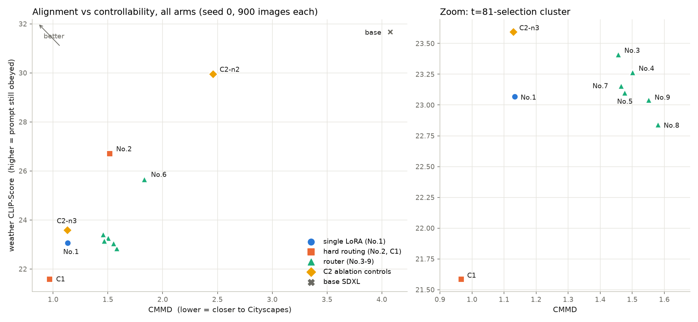

# 결론 정리 — Improving CA-LoRA + CA-LoRA with TimeStep Master

> 2026-09-21. 두 실험(2026-08 Improving CA-LoRA, 2026-09 CA-LoRA-TSM)을 문제 상황, novelty, 결과 및 ablation, 결론으로 짧게 묶은 문서.
> 수치의 출처: 본 저장소 `docs/RESULTS.md`, `docs/QUANTITATIVE.md`, `docs/QUALITATIVE_2026-09-19.md`, 상위 저장소 `Optimizing-CA-LoRA/docs/REPORT.md`.
> 공통 조건: SDXL base + Cityscapes, style 축 CA, 상위 2%(10,400개 head 단위 중 208개), rank 64 sliced LoRA. 평가는 CMMD(정렬, 낮을수록 좋음)와 weather CLIP-Score(날씨 프롬프트 제어성, 높을수록 좋음), 구성당 900장, **생성 seed 1개**, mIoU 없음.

## 1. 문제 상황

CA-LoRA(Park et al., CVPR 2025)는 concept-awareness(CA = E[‖∇L_Concept‖ / ‖∇L_Diff‖])가 높은 상위 2% 어텐션 헤드에만 LoRA를 붙여, 타깃 도메인에 정렬하면서도 프롬프트 제어성(악천후 합성)을 지키려는 방법이다.

약점은 CA가 측정 timestep *t*의 함수인데 그 *t*가 하나이고, 논문이 {1, 81, 201, 481} 중 t = 81을 CA 분포의 시각적 비교로 골랐다는 점이다. *t*는 학습이 아니라 **선택**에 쓰이므로, 이 휴리스틱 하나가 어떤 파라미터가 학습되는지를 통째로 정한다. 공식 코드도 없었다.

두 실험은 이 문제를 서로 다른 방향에서 다뤘다.

| | 질문 | 접근 |
|---|---|---|
| Improving CA-LoRA | *t*를 **더 잘 고를 수 있는가** | 정량 점수로 *t*를 순위화 |
| CA-LoRA-TSM | *t* 결정이 **불완전해도 괜찮게** 만들 수 있는가 | 단일 *t* 의존을 없애고 noise 구간별로 선택 |

두 번째 질문은 첫 번째의 실패에서 나왔다. 다른 도메인이나 백본(특히 timestep 정의가 다른 flow matching 계열)으로 옮길 때마다 *t*를 다시 탐색해야 하는 부담을 없애는 것이 실용적 목표였다.

## 2. Novelty

**Improving CA-LoRA**

- CA-LoRA 전체 재구현(CA 측정, head 단위 선택, sliced LoRA, 평가 프로토콜).
- 방향 보존 *t* 기준: CA는 노름 비라 방향을 버린다. 헤드별 정규화 그래디언트 방향을 남겨 축 간 방향 유사도(ews)로 13개 *t*를 순위화.
- 여러 *t*의 CA를 집계한 선택(multi-timestep aggregation).
- 학습 중 CA 재측정으로 선택 집합이 유지되는지 추적(drift).
- 통제: 무작위 2%(E_random), 전체 어텐션(E_all).

**CA-LoRA-TSM**

- 가설: 어떤 헤드가 concept에 민감한지는 noise level에 따라 다르므로, 구간마다 LoRA **가중치**뿐 아니라 **선택 집합(붙는 위치)**도 달라야 한다. TSM은 가중치만 구간별로 나눈다.
- 구간별 CA 선택 + 비균등 구간 expert(위에서부터 절반 자르기, 저노이즈 쪽이 촘촘함. n1/n3/n4/n5, 대표 *t* 41/81/201/375/750) + TSM식 core-context 라우터. 선택 위치가 expert마다 달라 게이트는 projection 행렬별, 활성화 함수 없음, 항등 초기화.
- 선택 집합의 *t* 의존 진단: 20개 *t*의 쌍별 Jaccard와, 측정 잡음 기준선으로서의 split-half Jaccard.
- 효과의 출처를 분리하는 통제: **C1**(구간별 학습은 그대로, 선택만 t = 81로 고정)과 **C2**([500, 999] expert만 비활성).
- 보조 도구: batch 1 학습 loss가 신호가 아니어서, 고정된 (이미지, *t*, ε) 96개에서 base와 expert를 짝지은 L_Diff 비교.

## 3. 결과 및 ablation

### 3.1 Improving CA-LoRA (10K step, 단일 LoRA)

| arm (style 축) | CMMD ↓ | weather CLIP ↑ |
|---|---|---|
| A: t = 81 (논문) | **0.638** | 21.00 |
| B: top-3 집계 | 0.711 | 20.69 |
| C: t = 41 (점수 1위) | 0.751 | **23.16** |
| D: t = 1 (점수 2위) | 0.752 | 19.96 |
| E_random (무작위 2%) | 0.681 | 23.76 |
| E_all (전체 어텐션) | 0.596 | 20.65 |
| base SDXL | 4.078 | 31.68 |

- 재현은 성공했다. 네 arm 쌍 모두에서 style은 정렬, viewpoint는 제어성에서 앞선다(논문 Figure 6의 대비).
- **정량 점수로 고른 *t*는 이기지 못했다.** 1위 t = 41은 CMMD에서 t = 81에 지고 제어성에서만 앞선다. 2위 t = 1은 두 지표 모두에서 지배당한다. 점수는 학습 결과를 단조롭게 예측하지 못했고, 남은 것은 "최적의 *t*는 지표에 따라 다르다"는 트레이드오프다.
- 통제가 가장 많은 것을 알려 줬다. 무작위 2%가 CMMD 0.681로 CA arm 8개 중 6개보다 좋고, weather 23.76은 style arm 전부보다 높다. 즉 2% 예산에서 도메인 흡수에 CA 선택은 필요 없고, style-CA로 고른 헤드는 오히려 제어성을 더 많이 잃는다. E_all은 논문의 전제(전체 파인튜닝은 정렬 최고, 제어성 붕괴)를 재현한다.
- 선택은 자기 학습을 견디지 못한다. 8개 run 전부에서 선택된 헤드가 약 500 step 안에 CA 상위 2% 밖으로 밀려나 돌아오지 않는다(Jaccard 0.07~0.16). 전체 CA 순위는 유지되므로(Spearman 0.77~0.95) 경계 부근의 순위 경쟁이다. CA 선택은 안정된 부분망이 아니라 학습 출발점이다.
- 서로 다른 noise level의 *t*는 상당히 다른 헤드 집합을 고른다. 이것이 두 번째 실험의 출발점이다.

### 3.2 CA-LoRA-TSM (expert당 4K step)

**진단.** 선택 집합의 *t* 의존은 실재한다. 인접한 *t*는 재측정 수준으로 비슷하지만 차이가 거리에 따라 누적된다(t = 81 대비 Jaccard: 121에서 0.59, 250에서 0.33, 500에서 0.11, 601 이상에서 0.02~0.05). 고노이즈 쪽은 선택 자체가 불안정하다(t = 401~701의 split-half Jaccard 0.33~0.48, 750과 981의 Jaccard 0.05).

**주 결과.**

| 구성 | CMMD ↓ | weather CLIP ↑ |
|---|---|---|
| No.1: 단일 CA-LoRA (t = 81, 4K) | 1.133 | 23.07 |
| No.2: n4 구간별 선택, 하드 라우팅 | 1.514 | **26.71** |
| No.3~5, 7~9: n1 포함 라우터 6개 | 1.46~1.58 | 22.8~23.4 |
| No.6: n3 + n4 + n5 라우터 (n1 없음) | 1.832 | 25.67 |
| C1: n4 구간, 선택 t = 81 고정 | **0.966** | 21.59 |
| C2-n2: No.2에서 [500, 999] expert 제거 | 2.459 | 29.95 |
| C2-n3: No.3에서 [500, 999] expert 제거 | 1.129 | 23.60 |
| base SDXL | 4.078 | 31.68 |

**Ablation에서 읽은 것.**

1. **구간별 선택의 효과 (No.2 vs C1).** 구간, step, seed가 같고 선택 집합만 다르다. 구간별 선택은 weather를 +5.13점 올리고 CMMD를 57% 악화시킨다. 효과는 크지만 "더 나은 성능"이 아니라 정렬과 제어성 사이의 **위치 이동**이다.
2. **구간별 학습(TSM) 쪽 차이 (C1 vs No.1).** 선택은 같지만 총 학습량도 다르다(C1 4 × 4K = 16K, No.1 4K). CMMD −14.7%, weather −1.48점. step 수만 늘려도 CMMD가 내려가므로(10K 단일 LoRA 0.638) 이 차이를 구간별 학습의 효과로 단정할 수 없다.
3. **위치를 정하는 것은 [500, 999] expert 하나다 (C2).** No.2에서 그 expert만 끄면 weather CLIP이 29.95(base 31.68, No.2 26.71)가 되고 CMMD는 2.46이 된다. No.3에서 그 구간을 n1에게 맡기면 No.1 자리(1.13 / 23.6)로 간다. 저노이즈 쪽 expert 3개의 몫은 작다.
4. **Assembling(라우터)은 이득이 없다.** n1을 포함한 라우터 6개는 한 덩어리로 뭉쳐 있고, No.1보다 정렬이 나쁘며 No.2보다 제어성이 낮다. n1이 없는 No.6은 두 지표 모두 No.2에 진다. set을 더할수록 조금씩 나빠지고, core를 n4에서 n5로 바꿔도 결과가 같다(No.5 ≈ No.7, No.8 ≈ No.9, 평균 픽셀 차이 2~3/255). 라우터는 *t* 의존을 거의 학습하지 않았다(E(t) 최대 0.11~0.14). context를 전역 0.82~0.93배로 누르는 정도였다.
5. **paired L_Diff.** 모든 구간에서 t = 81 선택(C1)이 구간별 선택보다 L_Diff를 더 낮춘다([500, 999]에서 −5.36% vs −4.46%). L_Diff는 정렬 축과 같은 방향이며 C1의 CMMD 우위와 맞는다.
6. **정성.** 정량 순서와 어긋나는 곳이 없다. t = 81 선택(No.1, C1)은 Cityscapes의 look(녹색 캐스트, 노출, 촬영 차량 보닛과 엠블럼)을 통째로 배우고 날씨 프롬프트를 거의 무시한다(night-time이 회색 낮으로 나옴). 구간별 선택(No.2)은 장면 구조만 배우고 look은 남겨, 짙은 안개, 황혼, 젖은 노면을 실제로 만든다. 라우터군은 t = 81의 캐스트에 번짐이 더해져 둘 다 잃는다.
7. **step 수도 같은 축의 손잡이다.** 같은 t = 81 선택에서 4K(1.133 / 23.07)는 10K(0.638 / 21.00)보다 정렬이 덜 되고 제어성이 더 남는다.

## 4. 결론 및 요약

**한 문장.** 두 실험에서 시도한 모든 개입(*t* 결정, 집계, 구간별 선택, 구간별 학습, 라우터, step 수)은 정렬과 제어성을 동시에 개선하지 못했고, 하나의 정렬-제어성 트레이드오프 곡선 위에서 위치만 옮겼다.

- ***t*를 잘 고르는 방법은 찾지 못했다.** 정량 점수는 학습 결과를 예측하지 못했고, 논문의 휴리스틱 t = 81은 정렬 기준에서는 끝까지 최선이었다. "최적의 *t*"는 어떤 지표를 보느냐에 달려 있다.
- **핵심 주장은 기각된다.** 선택 집합이 noise level에 따라 달라지는 것은 맞다(진단). 그러나 여러 *t* 구간의 선택을 나눠 쓰는 것은 결과를 개선하지 못하고, 정렬을 내주고 제어성을 얻는 쪽으로 위치만 옮긴다(No.2 vs C1). 결론은 *t*를 여러 구간에 분산하는 것이 아니라 t = 81처럼 제대로 된 *t* 하나를 고르는 것이 맞다는 것이다(설계의 1차 지표인 CMMD 기준).
- **여러 *t*의 정보를 쓰는 것은 전반적 향상으로 이어지지 않았다.** 집계(하나의 집합으로 평균)는 viewpoint 축에서 제어성 최고(25.62)와 CMMD 최악(1.576)으로 위치만 옮겼고, style 축에서는 t = 81에 두 지표 모두 조금씩 졌다. 구간별 분리(No.2)도 위치 이동, 라우터 혼합은 열세였다. 무작위 2%가 t = 41과 집계 선택을 두 지표 모두에서 앞서는 점까지 보면, "여러 *t*의 정보를 흡수했다"기보다 "t = 81 style 집합에서 멀어질수록 도메인 look의 흡수가 약해진다"는 희석으로 읽는 편이 데이터와 맞다. 다만 No.2가 "단일 LoRA를 더 일찍 멈춘 것"과 같은 곡선 위에 있는지는 확인하지 않았다(step 수별 기준 곡선 미측정).
- **"*t* 결정이 불완전해도 괜찮은 방법"이라는 원 목표는 달성되지 않았다.** 라우터로 여러 선택을 섞는 것은 효과가 없었다. 목표를 직접 시험하는 강건성 sweep(최저 구간 *t*를 바꿔 재학습)은 실시하지 못했다.
- **실용 규칙.** 결과를 움직이는 손잡이는 (i) 고노이즈 구간 [500, 999]에 어떤 선택 집합을 쓰는가, (ii) 학습 step 수 두 가지다. 정렬이 필요하면 t = 81 선택 + 구간별 학습(C1), 제어성이 필요하면 구간별 선택 + 하드 라우팅(No.2). 라우터와 다중 set은 비용(라우터당 약 2시간, 파라미터 최대 26%)만 든다.
- **CA 선택 자체에 대한 의문이 남는다.** 무작위 2%가 style-CA 선택과 비슷한 정렬(0.681 vs 0.638~0.752)에 더 높은 제어성을 보였고, 선택된 헤드는 500 step 안에 상위 2%에서 밀려난다. style 축 CA 선택이 무작위보다 나은 점을 CMMD와 CLIP-Score로는 보이지 못했다.

**한계.** 모든 수치는 생성 seed 1개이며 seed 간 분산을 재지 않았다(라우터군 내부의 CMMD 1.46~1.58 차이는 잡음 안일 수 있다. No.2 vs C1, C2 같은 큰 대조는 CLIP 표본오차 기준 z가 20 이상). 논문의 최종 지표인 mIoU가 없어, 트레이드오프 위의 어느 위치가 실제 세그멘테이션 데이터로 더 좋은지는 판정하지 못했다. 백본, 데이터셋, 축(style)이 각각 하나다. 두 실험의 단일 LoRA 수치는 step 수가 달라(10K vs 4K) 직접 비교 대상이 아니다.

**가장 값싼 다음 실험(한다면).** [500, 999] 구간의 선택만 바꿔 보는 것(t = 500/999, 집계 선택, 무작위 선택. fostering 1개 + 생성 1개에 약 5시간). C2가 그 구간이 손잡이임을 확인했으므로 정보량이 가장 크다.
