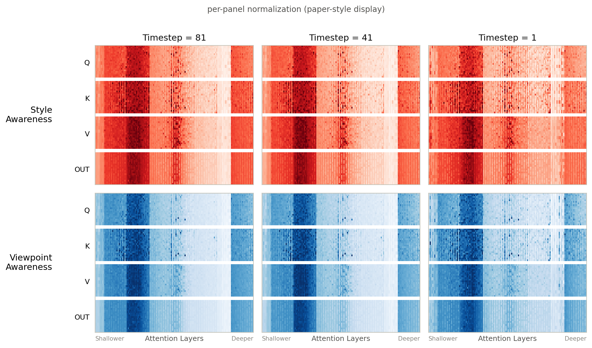
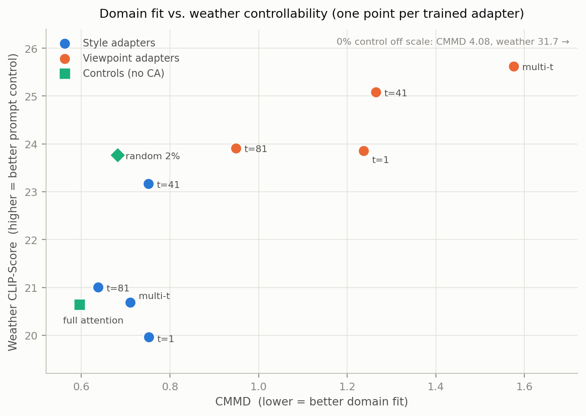
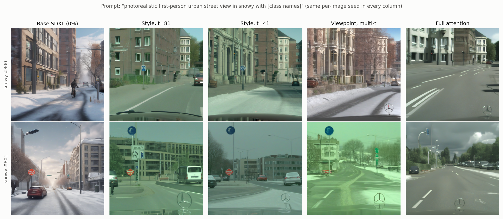
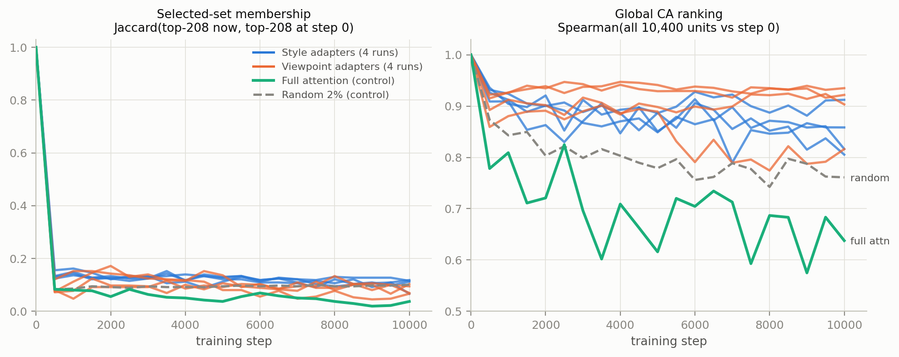

# Reproducing and Probing Concept-Aware LoRA: Timestep Selection, Multi-Timestep Aggregation, and Selection Drift

Technical report, August 2026.

## Abstract

Concept-Aware LoRA (CA-LoRA) [13] showed that fine-tuning only a small subset (top 2%)
of attention heads in a text-to-image diffusion model, those most responsive to a chosen
concept axis such as style or viewpoint, can adapt the model to a target domain while
preserving prompt controllability. The selection signal is measured at a single diffusion
timestep *t*, yet the paper chooses *t* heuristically. We fully reimplement CA-LoRA
(no official code was available) and propose a quantitative criterion for choosing *t*:
retaining gradient directions in addition to the gradient-norm ratios that define CA,
we rank timesteps by cross-axis directional similarity. We further study multi-timestep
aggregation of the head selection, and track whether the selection survives training.
Our reproduction recovers the paper's qualitative signature in all four arm pairs. Our
ranking places t=41, a timestep outside the paper's candidate set, first. This choice
does not improve domain fit (CMMD), where the paper's heuristic t=81 remains best, but
it yields the best weather-prompt controllability, revealing a metric-dependent
trade-off rather than a single optimal *t*. Finally, the selection does not survive
its own training: the chosen heads are pushed out of the top-2% set within ~500 steps
and never return over the 10k-step run. Because the global CA ranking is largely
preserved throughout, this is competition around the selection boundary, not a collapse
of the selected heads' CA.

## 1. Introduction

Text-to-image diffusion models can synthesize training data for dense prediction tasks,
but adapting them to a target domain tends to pull against the very property that makes
them useful: prompt controllability. Concept-Aware LoRA (CA-LoRA) [13] addresses this
tension by fine-tuning only the attention heads that respond most strongly to a chosen
concept axis, such as style or viewpoint. Concept-awareness (CA) is defined as the
expected ratio between the norm of a concept-perturbation gradient and the norm of the
standard diffusion-loss gradient, and the top 2% of heads by CA receive LoRA adapters
[8]. On Cityscapes [3], the paper shows that a style-selected adapter absorbs the target
domain while a viewpoint-selected adapter keeps weather prompts effective.

The CA score, however, depends on the diffusion timestep *t* at which gradients are
measured. The paper evaluates four candidates {1, 81, 201, 481} and picks t = 81 by
visually comparing the style and viewpoint CA distributions; no quantitative criterion
is given. This matters because the selection is sensitive to *t*: as we show later,
timesteps at different noise levels select substantially different head sets, so the
heuristic choice of *t* silently determines which parameters are trained. In addition,
no official implementation was available, so the method's behavior could not be
inspected directly.

This report does three things. First, we reimplement CA-LoRA end to end on SDXL [15]
and Cityscapes, including the paper's head-sliced LoRA parameterization. Second, we
propose a quantitative criterion for choosing *t*. CA is a ratio of gradient norms and
discards direction, so we additionally retain the normalized concept gradient
ĝ = ∇L_Concept / ‖∇L_Diff‖ per head and rank timesteps by cross-axis directional
similarity, preferring timesteps at which concept gradients are strong but directionally
distinct between axes. Third, we probe the selection itself: we aggregate selections
across the top-ranked timesteps, and we re-measure CA periodically during training to
test whether the selected set remains valid. Metric choices and decision rules were
fixed in advance where possible; the deviations are disclosed in Section 4.2. We
evaluate with the two metrics of the paper's Figure 6 analysis, CMMD [9] for domain
fit and CLIP-Score [5] for weather-prompt controllability; the paper's downstream
segmentation evaluation (mIoU) is out of scope.

Our findings are mixed in an informative way. The reproduction succeeds at the level
the paper's Figure 6 predicts: in all four arm pairs, style adapters achieve better
domain fit while viewpoint adapters better preserve weather-prompt controllability.
Our ranking places t = 41 first, a timestep outside the paper's candidate set. It does
not improve CMMD, where the paper's heuristic t = 81 remains best, but it yields the
best weather-prompt controllability, so quantitative *t* selection buys a metric-
dependent trade-off rather than a uniform improvement. Finally, the selection does not
survive its own training: within roughly 500 steps the selected heads are pushed out
of the CA top-2% and do not return, while the global CA ranking stays largely intact.

In summary, our contributions are:

- A complete reimplementation of CA-LoRA (no official code was available),
  covering CA measurement, head selection, sliced LoRA training, and the paper's
  evaluation protocol.
- A direction-preserving, quantitative timestep-selection criterion, evaluated over a
  13-timestep grid. It surfaces t = 41, outside the paper's candidate set, and reveals
  a trade-off between domain fit and prompt controllability.
- A multi-timestep aggregation study showing when aggregating selections across
  timesteps actually changes the selected set.
- A training-time stability analysis of the CA selection, identifying a consistent
  self-invalidation pattern across all eight runs.

## 2. Related Work

### 2.1 Efficient Fine-Tuning of T2I Models

Large-scale text-to-image (T2I) diffusion models [15, 17] are usually adapted to new
concepts or domains rather than retrained. Early personalization methods sit at two
extremes: Textual Inversion [4] optimizes only a text embedding while freezing the
model, whereas DreamBooth [18] fine-tunes the full network for a target subject.
Parameter-efficient fine-tuning, most prominently LoRA [8], lowers the cost of
adaptation by training low-rank weight updates, and later variants such as AdaLoRA [22]
allocate the parameter budget adaptively across weights during training. These methods
reduce how much is trained, but not where: updates still reach every targeted layer
regardless of its relevance to the concept being learned. Two further lines address the
"where" question. Lee et al. [10] show that fine-tuning a well-chosen subset of layers
can outperform full fine-tuning under distribution shift, and Basu et al. [1] localize
the layers controlling individual visual attributes in T2I models through ablation.
CA-LoRA [13] combines these threads: it replaces manual localization with a
gradient-based score computed per attention head, and restricts LoRA updates to the
heads that score highest for a chosen concept.

### 2.2 Concept-Aware LoRA

CA-LoRA [13] targets domain-aligned segmentation dataset generation: a T2I model is
fine-tuned on the target dataset (Cityscapes [3]) so that generated images match the
target domain, while prompt controllability is preserved for synthesizing unseen
conditions such as adverse weather. The method scores every attention head by its
concept awareness, CA = E[‖∇_θ L_Concept‖ / ‖∇_θ L_Diff‖], where
L_Concept = ‖ε_θ(x_t, c, t) − sg[ε_θ(x_t, c_Aug, t)]‖² measures how strongly the head's
parameters react when the prompt c is perturbed toward a concept axis (c_Aug, e.g.
style or viewpoint rephrasings), and L_Diff is the standard diffusion loss [6]. Heads
in the top 2% by CA receive rank-64 LoRA adapters attached to the corresponding head
slices of the fused projection matrices (output rows for Q/K/V, input columns for OUT),
and only these are trained.

Both gradients are evaluated at a single diffusion timestep *t*. The paper compares
the style and viewpoint CA distributions over four candidates {1, 81, 201, 481} and
selects t = 81 heuristically. Its analysis then shows a characteristic contrast between
the two concept axes: the style-selected adapter wins on domain fit (CMMD [9]) but
loses weather-prompt controllability, while the viewpoint-selected adapter preserves it
(CLIP-Score [5]); the headline mIoU results are reported in few-shot regimes. The
timestep choice, however, remains the one manual step in an otherwise automated
pipeline, and this report quantifies it.

## 3. Method

### 3.1 CA Measurement at Head Granularity

The paper's selection unit is the theoretical attention head inside each fused
projection matrix. In the SDXL UNet there are 560 fused projections (70 attention
modules × 2 attention blocks × {Q, K, V, OUT}); with a global head width d_h = 64,
640-channel blocks contribute 10 heads per projection and 1280-channel blocks 20,
for a total of **U = 10,400 head units** (we verified that the per-unit parameter
counts partition all 955,187,200 attention-projection parameters exactly). A unit is
a row slice of its projection for Q/K/V and a column slice for OUT, matching the
paper's Algorithm 2. The top-2% budget is a **unit count**: ⌊0.02 · 10,400⌋ = 208
units per selection, following the paper's "top-k% of projection layers" phrasing.
Because unit widths differ across blocks, the effective parameter fraction varies by
selection (2.09-2.37% in our arms).

Per-head CA is the expectation of the per-sample norm ratio, not the ratio of
expectations: for each sample we compute ‖g_c[h]‖ / ‖g_d[h]‖ on the head slice and
average across samples, which matches the paper's per-sample chunk-RMS formulation.
One measurement pass uses 256 Cityscapes training images (center crop, 1024²) × 4
concept perturbations per sample per axis, drawn without replacement from the paper's
five c_Aug templates per axis (Appendix B.2 of [13]), giving 1,024 concept-gradient
contributions per axis per timestep. Three invariants protect the estimand:

- **Batch size 1.** With batch > 1 the quantity silently becomes
  E[‖Σg_c‖ / ‖Σg_d‖], a different estimator; the measurement path enforces b = 1.
- **Paired axes.** At a given sample, both axes share the same noised latent x_t and
  the same base prediction, so style/viewpoint differences are not confounded by
  noise draws.
- **Paired timesteps.** The noise draw per sample is independent of *t*, so
  cross-timestep comparisons are paired as well.

All measurements run in fp32.

### 3.2 A Direction-Preserving Timestep Criterion

CA is a norm ratio, so it discards gradient direction. We additionally accumulate the
normalized concept gradient ĝ = ∇L_Concept / ‖∇L_Diff‖ per unit and per axis, and
compare the two concept axes directionally. Cosine similarity between gradients of
two objectives is an established conflict signal in multi-task learning [21]; here we
repurpose it across concept axes as a timestep-quality signal. The working hypothesis:
a good *t* is one at which concept gradients are strong (high CA) but directionally
distinct between axes (low cross-axis similarity), because a head that pushes in the
same direction for style and viewpoint cannot be adapted for one axis without dragging
the other.

The per-unit cross-axis similarity is cos(E[ĝ_style], E[ĝ_viewpoint]): the implicit
1/‖g_d‖ weighting matches CA's own normalization, and averaging before the cosine
matches how training itself averages gradients. From this we compute two timestep
scores, both fixed before measurement:

- **Expanded weighted similarity (ews, primary)**: over the top n·k units by CA
  (n = 5, i.e. 1,040 units, to soften the selection boundary), the CA-weighted mean
  cross-axis similarity. Lower is better.
- **conflict_count (auxiliary)**: the number of selected units whose cross-axis
  similarity exceeds a pooled-quantile threshold (primary quantile 0.3, swept over
  {0.1, ..., 0.5}). A pre-registered demotion rule stated that if the timestep
  ranking inverts across the quantile sweep, conflict_count loses primary-metric
  status. The rule fired (Section 5.1); ews was the primary metric throughout.

Two reliability instruments accompany the scores. **Split-half agreement** recomputes
the full ranking on even/odd sample halves (split by sample, since within-sample
contributions are correlated) and reports the Spearman correlation between the two
half-rankings. **Direction concentration**, ‖E[ĝ]‖ / E[‖ĝ‖] ∈ [0, 1], measures
whether an axis's templates push in a consistent direction; its random-direction
floor is ≈ 1/√1024 ≈ 0.031, and values near the floor would warn that a template set
is directionally incoherent (relevant because the paper's own template set includes
an eye-level viewpoint template that could partially cancel the axis mean).

### 3.3 Multi-Timestep Aggregated Selection

If different timesteps see genuinely different structure, aggregating them might
select a better head set than any single *t*. We normalize CA within each timestep
(so that no timestep dominates by scale), average the normalized scores over the
top-ranked timesteps, and select the top 208 units of the aggregate. Our main
aggregation arm B uses the top three timesteps by ews, [41, 1, 81]. The arm matrix is
designed for complete decomposition: each component of B is also trained alone
(C = 41, D = 1, A = 81), so any advantage of B can be attributed either to
aggregation or to one of its components.

### 3.4 Tracking CA During Training

To test whether the selection remains valid while it is being trained, we re-measure
CA every 500 steps (20 snapshots per 10k-step run) on a fixed 64-sample subset and
compare against a **step-0 baseline measured with the same 64 samples**. Re-measuring
the baseline, rather than reusing the 256-sample selection scores, separates
estimation noise from genuine drift; the overlap between the step-0 top-208 and the
trained selection additionally quantifies that noise floor per run. We track the
Jaccard overlap of the current top-208 with the baseline top-208 (membership drift)
and the Spearman correlation of the full 10,400-unit CA ranking (global landscape
drift). Snapshots run under bf16 autocast after passing a pre-registered equivalence
gate against fp32 (rank Spearman 0.9988, top-2% Jaccard 0.935, 1.89× faster); the
gate thresholds were fixed as module constants before running.

## 4. Experimental Setup

### 4.1 Reproduction Protocol

**Model and data.** SDXL base 1.0 [15] in fp32 on a single A100 80GB. Cityscapes [3]
train (2,975 images) for CA measurement and fine-tuning; val (500 images) as the CMMD
reference set. Captions during training use the paper's fixed prompt "photorealistic
first-person urban street view".

**Adapters.** The paper's two sliced-LoRA parameterizations (its Appendix A.2,
Algorithms 3-4): one rank-64 adapter per fused projection, covering the union of that
projection's selected heads. For Q/K/V (type B) the A matrix is full-width and the B
matrix covers only the selected output rows; for OUT (type A) the B matrix is
full-width and A reads only the selected input columns. Partial selections are never
silently widened to the full matrix; checkpoints record the head-index tensor plus
granularity and axis metadata, and mismatched loads are refused.

**Training.** 10,000 steps, batch 1, constant lr 1e-4, AdamW [11] (β = 0.9/0.999,
weight decay 0.01), loss = L_Diff only (L_Concept is a measurement-time quantity),
random 1024² crop with random horizontal flip, following the paper's Table 12.

**Generation and arms.** Per run: 500 in-domain images (prompt + "with [class
names]" extracted from label maps) and 4 weather conditions (foggy, night-time,
rainy, snowy) × 100 images (prompt + "in [weather]"), 25 Euler steps, classifier-free
guidance [7] 5.0, deterministic per-image seeds. Trained arms: {A: t=81, B: top-3
aggregate, C: t=41, D: t=1} × {style, viewpoint} = 8 runs, plus two controls without
CA selection (E_random: 208 random units at the same budget; E_all: all 10,400 units)
and a 0% control (base SDXL, no training). All runs share identical training data,
schedule, and evaluation.

### 4.2 Deviations from the Paper

Table 1 lists every known deviation. The most consequential is the first: the paper's
headline tables are few-shot (its T2I fine-tuning sees ~0.3% of Cityscapes, roughly 9
images over ~1,100 epochs), whereas we train on the full 2,975-image split (~3.4
epochs). Diverse-data domain absorption improves CMMD dramatically, so our absolute
CMMD values are not comparable to the paper's; our reproduction claim rests on the
relative style/viewpoint signature (Section 5.3), which is data-scale invariant in
direction. Calibrating the scale end to end, our 0% control scores CMMD 4.078 against
the paper's 0% value of 5.063 (same order, ~20% offset from CLIP-preprocessing and
reference-set differences), while the 0%→2% improvement ratio is 6.4× for us versus
3.6× for the paper, consistent with the data-scale explanation.

| # | Item | Paper | This work | Nature |
|---|---|---|---|---|
| 1 | T2I training data | few-shot subset (~9 images, ~1,100 epochs) | full train, 2,975 images (~3.4 epochs) | intentional deviation; voids absolute CMMD comparison |
| 2 | Evaluation scope | 4-stage pipeline up to mIoU | Stages 1-2; CMMD + CLIP-Score | scope decision (Section 4.3) |
| 3 | Timestep choice | heuristic over {1, 81, 201, 481} | 13-t grid + quantitative criterion | contribution 1 |
| 4 | Arm design | single t | + aggregation (B), t-ablations (C, D) | contribution 2 |
| 5 | Aggregation width | (n/a) | pre-registered top-5, changed to top-3 after the ranking was computed but before any training | disclosed change (Section 5.2) |
| 6 | Full/random ablations | included | excluded at first for scope, re-included after the 8-run matrix finished: negative controls proved necessary to discriminate the value of CA selection, and GPU time had freed up | scope change, disclosed |
| 7 | CA sample count | unspecified | 256 samples × 4 augmentations | our choice |
| 8 | CMMD reference set | unspecified | Cityscapes val 500, center crop | our choice |
| 9 | CLIP backbone | unspecified | ViT-L/14 | our choice (literature standard) |
| 10 | Loss reduction | sum (‖·‖²) | mean | invariant for CA (constants cancel in the ratio); fp-range safety |
| 11 | Training seeds | unspecified | 1 per arm | limitation (Section 7) |
| 12 | c_Aug templates | Appendix B.2 sets | identical (verbatim) | match |
| 13 | Training hyperparameters | Table 12 | identical | match |
| 14 | Generation protocol | 25 steps, guidance 5.0, class-name prompts | identical | match |

One implementation-history disclosure belongs here as well. Our first implementation
selected at the granularity of whole fused projection matrices (560 units) under a
parameter budget, misreading the paper's unit. We judged this an error rather than an
acceptable variant, re-derived everything at head granularity (measurement included),
and re-ran the pipeline. The module-granularity artifacts were kept and turned out to
be scientifically useful as an ablation on measurement resolution; Appendix B reports
them.

### 4.3 Evaluation

**CMMD** [9] (domain fit, lower is better): maximum mean discrepancy between CLIP
ViT-L/14 [16] embeddings of the 500 in-domain generations and the 500 center-cropped
Cityscapes val images, Gaussian kernel σ = 10, scaled ×1000. **CLIP-Score** [5]
(prompt adherence, higher is better): 100 × cosine similarity between each generated
image's embedding and its own generation prompt, averaged per condition over all 900
images per run; the weather score is the arithmetic mean of the four adverse
conditions, following the paper's Figure 6 protocol (100 images per condition). The
paper cites only the CLIP backbone for this metric and does not specify it; we cite
the metric's source [5] and fix the backbone to ViT-L/14 for both metrics. The 0%
control (base SDXL under the identical generation protocol) anchors both scales.

We do not evaluate downstream segmentation (mIoU). The paper's mIoU results measure
the full four-stage system including the label generator (Stages 3-4), which lies
outside our research questions; the adapter-level trade-off we study is what the
paper's Figure 6 analyzes with CMMD and CLIP-Score. Reproducing the downstream stages
would roughly double the compute budget of this study, and we leave it to future work.

## 5. Results

### 5.1 Timestep Ranking

The measurement grid covers 13 timesteps [1, 41, 81, 121, 201, 301, 401, 481, 601,
701, 801, 901, 981]: all four paper candidates, a fine step of 40 in the low-t region
where the paper's winner sits, and coarse coverage of the full schedule so that a
low-t advantage is tested rather than assumed. Table 2 shows the head-level ranking.

| rank | t | ews ↓ | conflicts @0.3 | CA style | CA viewpoint | concentration style | concentration viewpoint |
|---|---|---|---|---|---|---|---|
| 1 | **41** | **0.256** | 120 | 0.113 | 0.090 | 0.380 | 0.317 |
| 2 | 1 | 0.372 | 37 | 0.110 | 0.076 | 0.443 | 0.368 |
| 3 | 81 | 0.382 | 95 | 0.130 | 0.111 | 0.358 | 0.314 |
| 4 | 481 | 0.500 | 50 | 0.275 | 0.212 | 0.293 | 0.203 |
| 5 | 601 | 0.539 | 55 | 0.294 | 0.252 | 0.282 | 0.206 |
| 6 | 121 | 0.540 | 44 | 0.148 | 0.131 | 0.342 | 0.305 |
| 7 | 801 | 0.575 | 32 | 0.385 | 0.291 | 0.376 | 0.258 |
| 8 | 401 | 0.607 | 34 | 0.255 | 0.211 | 0.305 | 0.223 |
| 9 | 901 | 0.665 | 21 | 0.431 | 0.296 | 0.457 | 0.317 |
| 10 | 701 | 0.699 | 19 | 0.339 | 0.254 | 0.304 | 0.230 |
| 11 | 201 | 0.759 | 17 | 0.198 | 0.181 | 0.333 | 0.298 |
| 12 | 301 | 0.788 | 10 | 0.251 | 0.229 | 0.318 | 0.277 |
| 13 | 981 | 0.868 | 8 | 0.623 | 0.294 | 0.647 | 0.427 |

**Table 2.** Head-level timestep ranking by ews (primary, lower is better), with the
auxiliary conflict count at the primary quantile, per-axis mean CA of the selected
set, and direction concentration.

Four observations:

- **t = 41 ranks first on both metrics** at the primary quantile (ews 0.256 by a wide
  margin; conflict count 120, also the maximum). It lies outside the paper's candidate
  set and could only be found by the fine low-t grid. The paper's t = 81 ranks third,
  and notably has the **largest CA magnitude within the low-t cluster** {1, 41, 81}
  (0.130/0.111), a fact that becomes central in Section 5.4. The paper's candidate
  t = 201 ranks 11th of 13.
- **The ranking is statistically reliable.** Split-half Spearman for ews is 0.956,
  and both halves produce the same top-3 set {41, 1, 81}. A weighting-invariant
  control estimator (averaging per-sample cosines instead of taking the cosine of
  mean directions) agrees on the leading timesteps but ranks less stably (0.775),
  so the ranking is carried by the direction signal rather than by the similarity
  estimator's implicit 1/‖g_d‖ weighting.
- **The pre-registered demotion rule fired for conflict_count.** At module granularity
  the t = 41 vs t = 81 order inverts across the quantile sweep (81 ahead at q = 0.1,
  41 ahead at q = 0.3), which by the pre-registered rule removes conflict_count from
  primary-metric status; its split-half Spearman there was also the lowest of all
  metrics (0.646). At head granularity the same inversion still exists at q = 0.1
  (counts 45 vs 55), but stability improves substantially (split-half 0.837), because
  the count range grows from 0-9 to 8-120 and the "hard threshold × small integer"
  discreteness is diluted. The demotion stands (rules are not re-litigated after
  seeing data), but the mechanism itself proved to be resolution-dependent, which we
  consider a finding in its own right (Section 6).
- **The template sets are directionally coherent.** Direction concentration is
  0.20-0.65 across all timesteps and axes, 6-20× the random floor (≈ 0.031), so the
  concern that the paper's eye-level viewpoint template might cancel the axis mean is
  not borne out. The profile is U-shaped in *t* (highest at both schedule ends) and
  style exceeds viewpoint everywhere, foreshadowing the axis asymmetry in Section 5.6.

**Figure 1.** Per-head CA across the UNet's attention layers for the low-t cluster
(t = 81, 41, 1), per-panel normalized as in the paper's display. Both axes concentrate
CA in the same mid-depth region, and the three timesteps look similar at this level;
the selection differences quantified in Section 5.2 live in the tails.

### 5.2 Structure of the Selected Sets

Before training, the selections themselves already answer two design questions.

**The two axes select substantially different heads.** Within each arm, the style and
viewpoint selections share only 83-113 of 208 units (40-54%; A 40%, B 45%, C 47%,
D 54%). The premise of the paper's Figure 6 experiment, that style-CA and
viewpoint-CA identify different functional circuitry, holds at the selection level
before any training. Across arms within one axis, the low-t cluster is coherent:
selections among {A, B, C} share 74-82%, while pairs involving D (t = 1) drop to
50-64%, except B-D on style (82%), which is expected since B's aggregate contains
t = 1. The random control E_random shares at most 4 of 208 units with any CA
selection.

**Aggregation only became meaningful at head resolution.** At module granularity the
top-3 aggregate degenerated: 9 of its 10 modules coincided with A's single-t
selection, so training it would have tested a one-module difference against seed
noise, and we rejected it. At head resolution (10,400 units) the aggregate moves the
selection substantially: B shares 81% with A and 82% with C, the same level as the
A-C baseline (79%), so aggregation genuinely changes which heads are trained. The
pre-registered aggregation width was top-5; we changed it to top-3 after the head
ranking was computed but before any training, because the 3rd-to-4th gap (0.382 →
0.500) is the largest in the ranking while the 5th-to-6th boundary (0.539 vs 0.540)
is a tie that cannot be defended. Selection composition: 56-67 modules per arm,
type A (OUT) 4-10 and type B (Q/K/V) 49-60 matrices, 6.6-7.9M LoRA parameters,
effective 2.09-2.37% of attention parameters (E_random: 2.03%).

### 5.3 Main Results and the Reproduction Signature

Table 3 reports all metrics for the 8 CA runs, the two controls, and the 0% baseline.

| arm (t) | axis | CMMD ↓ | CLIP in-dom | foggy | night | rainy | snowy | weather mean ↑ |
|---|---|---|---|---|---|---|---|---|
| A (81, paper) | style | **0.638** | 22.08 | 23.79 | 20.45 | 20.75 | 19.02 | 21.00 |
| B (top-3) | style | 0.711 | 22.64 | 23.15 | 19.70 | 20.80 | 19.11 | 20.69 |
| C (41) | style | 0.751 | 23.18 | 24.73 | 23.21 | 22.37 | 22.36 | **23.16** |
| D (1) | style | 0.752 | 21.62 | 23.15 | 18.08 | 20.07 | 18.55 | 19.96 |
| A (81, paper) | viewpoint | **0.949** | 23.09 | 24.83 | 21.77 | 24.58 | 24.46 | 23.91 |
| B (top-3) | viewpoint | 1.576 | 25.50 | 26.19 | 24.33 | 25.99 | 25.98 | **25.62** |
| C (41) | viewpoint | 1.265 | 24.25 | 25.92 | 22.68 | 26.20 | 25.52 | 25.08 |
| D (1) | viewpoint | 1.237 | 23.48 | 25.21 | 22.13 | 24.47 | 23.62 | 23.86 |
| E_random (2%, no CA) | — | 0.681 | 22.99 | 25.88 | 22.68 | 25.04 | 21.46 | 23.76 |
| E_all (full attention) | — | 0.596 | 21.84 | 24.31 | 18.87 | 21.53 | 17.87 | 20.65 |
| 0% control (base SDXL) | — | 4.078 | 28.81 | 32.86 | 30.26 | 32.03 | 31.56 | 31.68 |

**Table 3.** Main results. CMMD: 500 in-domain generations vs. Cityscapes val.
CLIP-Score per condition; weather mean over the four adverse conditions. All trained
runs use one seed.

**The reproduction signature holds in 4 of 4 arm pairs.** For every selection
criterion (A, B, C, D), the style adapter has lower CMMD than the viewpoint adapter
(0.638 < 0.949, 0.711 < 1.576, 0.751 < 1.265, 0.752 < 1.237) and the viewpoint
adapter has the higher weather CLIP-Score (gaps +2.91, +4.93, +1.92, +3.89). This is
the qualitative contrast of the paper's Figure 6, reproduced under a quantitative,
pre-registered criterion. Relative to the 0% control, the precise statement is that
**both** axes lose weather controllability when they absorb the domain, but style
loses far more: −8.5 to −11.7 points versus −6.1 to −7.8 for viewpoint. And since
B_style ≈ A_style (weather gap 0.31), the style-side collapse is a structural
property of the style axis, not an artifact of any particular timestep choice.

### 5.4 Timestep Effects: a Domain-Fit vs. Controllability Trade-off

**Figure 2.** Domain fit vs. weather controllability. No trained arm wins both
metrics; the 0% control (off scale, top right) wins controllability by refusing
adaptation entirely.

The two evaluation metrics rank the timesteps differently:

- **CMMD prefers the paper's heuristic.** A (t = 81) is best on both axes (0.638
  style, 0.949 viewpoint). The ews winner t = 41 trails it on CMMD (0.751 / 1.265).
- **Weather controllability prefers the ews ranking's leaders.** C (t = 41) is the
  best style arm (23.16, +2.16 over A_style), and B (top-3) is the best viewpoint arm
  (25.62), beating all three of its own decomposition components (A 23.91, C 25.08,
  D 23.86). Aggregation therefore has a real effect beyond its best component, but it
  buys controllability, not domain fit: B's CMMD is the worst of its group on both
  axes (1.576 on viewpoint).
- **D (t = 1) is dominated.** On style, C matches its CMMD (0.751 vs 0.752) while
  scoring +3.2 weather points; on viewpoint, A beats it on both metrics. Since t = 1
  was ranked second by ews, the ews order does not carry monotonically into training
  outcomes.

Our interpretive hypothesis, which the present data cannot confirm (one seed per arm,
three timesteps in the cluster), is a **two-factor account**: CMMD tracks CA
*magnitude* (within the low-t cluster, t = 81 has the largest CA and the best CMMD,
t = 1 the smallest and the worst), while controllability preservation tracks *low
cross-axis similarity* (t = 41, the ews winner, and its aggregate B hold the weather
optima). Under this account the two metrics optimize different things and no single
*t* is "best"; ews is a useful predictor specifically for the controllability side of
the frontier.

**Per-condition asymmetry.** The viewpoint-minus-style gap is not uniform across
weather conditions:

| condition | A | B | C | D |
|---|---|---|---|---|
| foggy | +1.05 | +3.03 | +1.20 | +2.06 |
| night-time | +1.32 | +4.63 | −0.53 | +4.04 |
| rainy | +3.83 | +5.19 | +3.84 | +4.39 |
| snowy | +5.44 | +6.88 | +3.16 | +5.07 |

**Table 4.** Weather CLIP-Score gap (viewpoint − style) per condition. Foggy is the
smallest gap in every pair; snowy and rainy are the largest; C's night-time entry is
the only reversal.

A plausible but unverified explanation: Cityscapes itself contains overcast and hazy
captures, so foggy collides least with the absorbed domain style, while snowy and
rainy are most alien to it and the style adapter's pull overrides the prompt most
strongly there.

**Figure 3.** Qualitative check on the snowy condition (the largest-gap condition).
Each column is one model, each row one prompt and per-image seed, identical across
columns. The 0% control renders heavy snow but not the driving viewpoint. The style
adapters and E_all adopt the Cityscapes look, including the ego-vehicle hood and its
donor vehicle's hood ornament, and largely suppress the requested snow; C (t = 41)
retains visibly more snow than A (t = 81), consistent with its higher weather score.
The viewpoint adapter keeps both the driving viewpoint and the snow. (Images
auto-selected as the first two snowy indices; they are illustrative, not a systematic
review.)

### 5.5 Controls: Random and Full Fine-Tuning

The two no-CA controls sharpen what the CA arms do and do not show:

- **CMMD alone cannot discriminate CA selection.** E_random, 208 random units at the
  same budget with no concept signal at all, reaches CMMD 0.681, third best overall
  and ahead of six of the eight CA arms. Domain absorption at 2% budget evidently
  does not require concept-aware placement. This mirrors the paper's own tables,
  where full LoRA wins the domain-fit metric; the value of CA selection lies in
  controllability (and, in the paper, mIoU), not in domain fit.
- **The style collapse is specific to style-CA heads.** E_random's weather score
  (23.76) sits at viewpoint-arm level, so collapsing weather control is not something
  any 2% adapter does; it is what the heads selected by style-CA do (style arms:
  19.96-23.16, mean much lower).
- **Full fine-tuning reproduces the paper's premise.** E_all (all 10,400 units) is
  the best domain fit of the study (CMMD 0.596) and simultaneously collapses weather
  control to style-arm level (20.65; night 18.87 and snowy 17.87 are among the worst
  entries in the table). This is precisely the failure mode that motivates CA-LoRA in
  the paper's Figure 1: unrestricted fine-tuning absorbs the domain and loses the
  prompt. Our pipeline reproduces it independently.

### 5.6 CA Drift During Training

| run | baseline ∩ trained¹ | Jaccard @500 | Jaccard @10k | Spearman range |
|---|---|---|---|---|
| A style | 0.70 | 0.156 | 0.112 | 0.79-0.93 |
| B style | 0.66 | 0.134 | 0.115 | 0.81-0.93 |
| C style | 0.73 | 0.130 | 0.118 | 0.85-0.94 |
| D style | 0.77 | 0.124 | 0.067 | 0.82-0.91 |
| A viewpoint | 0.24 | 0.121 | 0.067 | 0.77-0.92 |
| B viewpoint | 0.23 | 0.075 | 0.069 | 0.92-0.95 |
| C viewpoint | 0.26 | 0.072 | 0.103 | 0.92-0.95 |
| D viewpoint | 0.37 | 0.081 | 0.095 | 0.86-0.92 |
| E_random | 0.005² | 0.083 | 0.101 | 0.74-0.87 |
| E_all | 0.020² | 0.083 | 0.037 | 0.57-0.82 |

**Table 5.** Drift summary. ¹ Jaccard between the step-0 re-measured top-208 (64
samples) and the trained selection (256 samples): the estimation-noise floor of the
comparison. ² Not meaningful for the controls (their trained sets are not CA-based);
listed for completeness.

**Figure 4.** Left: membership of the CA top-208 collapses within the first 500 steps
in every run and never recovers. Right: the global CA ranking stays largely intact
for 2% adapters, degrades partially for E_random, and is progressively reshaped by
full fine-tuning (E_all).

Three findings:

1. **Self-invalidation, 8 of 8 runs.** Within 500 steps, the Jaccard overlap between
   the current top-208 and the step-0 top-208 falls to 0.07-0.16 and plateaus there
   (0.05-0.17) for the rest of the 10k-step run: training pushes the very heads being
   trained out of the CA top-2%, and other heads take their places. The tracked set's
   mean CA does not collapse (it stays in 0.08-0.19 throughout), so this is rank
   competition around the selection boundary, not a disappearance of the selected
   heads' concept-awareness.
2. **The global landscape stays put under sparse training.** For all eight CA arms
   the full-ranking Spearman remains 0.77-0.95 across 10k steps. The controls order
   themselves by training scale: E_random drifts somewhat more (0.74-0.87), and
   E_all, which trains everything, progressively reshapes the landscape itself
   (0.57-0.82, final 0.64). Sparse 2% training perturbs the CA landscape locally;
   full training rewrites it.
3. **Axis asymmetry is largely an estimation effect.** The noise-floor column
   (baseline ∩ trained) is 0.66-0.77 for style but only 0.23-0.37 for viewpoint: the
   viewpoint top-208 is far less reproducible between a 64-sample and a 256-sample
   measurement even before training, consistent with viewpoint's lower CA magnitude
   and direction concentration (Table 2). Viewpoint drift numbers should therefore be
   read against a much noisier baseline.

The selection is thus a snapshot of the training start, not an invariant of training.
Notably, the Figure 6 signature still emerges from that snapshot (Section 5.3), so
the initial selection determines the training trajectory; whether periodic
re-selection would do better is an open question (Section 6).

## 6. Discussion

**What is a good t? It depends on the objective.** The paper's heuristic choice
t = 81 is empirically vindicated on domain fit: it wins CMMD on both axes. Our
quantitative criterion surfaces a different timestep, t = 41, that wins weather
controllability on the style side, with its aggregate winning on the viewpoint side.
The two metrics form a small trade-off frontier over timesteps (Figure 2), and the
practical reading of our two-factor hypothesis (Section 5.4) is that CA magnitude and
cross-axis direction capture different, complementary aspects of a timestep. A
criterion combining both, for example selecting *t* on the Pareto set of (high CA,
low ews), is the natural next experiment; ews alone is not a monotone predictor of
training outcomes (t = 1 ranked second and finished last).

**Metric stability depends on measurement resolution.** Two independent phenomena
changed qualitatively between 560 fused-module units and 10,400 head units: the
conflict_count metric went from unusable (split-half 0.646, rank inversions across
quantiles) to reasonably stable (0.837), and top-3 aggregation went from degenerate
(9/10 modules identical to the single-t selection) to genuinely selection-moving.
Neither the metric nor the aggregation idea was wrong; they were both starved of
resolution. We suggest treating unit granularity as a first-class design parameter in
any selection-based fine-tuning method, and checking metric stability at the chosen
resolution before pre-registering decision rules on it.

**The selection does not survive its own training.** The self-invalidation pattern
(Section 5.6) means CA-based selection is best understood as identifying a good
starting configuration rather than a persistent property of the trained heads. That
the method works anyway suggests the initial gradient geometry is what matters. It
also raises a concrete follow-up: re-measuring CA mid-training and re-allocating the
adapter budget, in the spirit of AdaLoRA's dynamic budget allocation [22], might
either help (tracking the true top-2%) or hurt (chasing boundary noise, given that
the plateau reflects competition among near-boundary heads). Our drift data cannot
distinguish these, but provides the measurement machinery to test them.

**Evaluation design matters as much as selection design.** E_random matching most CA
arms on CMMD shows that a domain-fit metric alone cannot certify a selection method;
any 2% adapter absorbs the domain. The discriminating signal lives in the
controllability metric, and in the paper's setting presumably in mIoU. Studies of
selective fine-tuning should always pair an adaptation metric with a
preservation metric, and should include a random-selection control at matched budget,
which is cheap and, in our case, was the single most clarifying run in the study.

## 7. Limitations

- **One seed per arm.** Every trained number in Tables 3-5 comes from a single seed.
  The style-side CMMD differences between B, C, and D (0.711-0.752) and several
  weather gaps are plausibly within seed noise; the 4/4 signature and the
  E-control contrasts are large and consistent enough that we do not expect them to
  flip. Re-running the main arms with 3 seeds is the highest-value addition.
- **No downstream segmentation.** Because we do not measure mIoU, our
  CMMD-controllability trade-off cannot be adjudicated at the level that ultimately
  matters for dataset generation; whether t = 41's controllability gain or t = 81's
  domain fit translates into better segmentation data remains open.
- **Qualitative evidence is illustrative.** Figure 3 shows two auto-selected prompts;
  we did not perform a systematic visual review of the 9,900 generated images, and
  the per-condition hypotheses of Section 5.4 remain unverified.
- **Memorization was not audited.** CMMD does not penalize memorization. A
  nearest-neighbor check of generations against training images [2] is advisable
  before using such adapters for dataset generation, although full-dataset training
  at ~3.4 epochs makes verbatim memorization less likely than in the paper's
  ~1,100-epoch few-shot regime.
- **Predictive scope of ews.** ews was selected as primary before training, but its
  ranking is not monotone in training outcomes (t = 1). The two-factor account that
  explains our results is post-hoc and needs a dedicated experiment.
- **Single model, dataset, and backbone.** All conclusions are for SDXL base on
  Cityscapes with CLIP ViT-L/14 metrics; none of the three was varied.

## 8. Conclusion

We reimplemented CA-LoRA end to end at the paper's head granularity and reproduced
its central qualitative claim under a pre-registered criterion: in all four arm
pairs, style-selected adapters absorb the target domain more deeply while
viewpoint-selected adapters preserve weather-prompt controllability, and the no-CA
controls bracket both behaviors (random selection matches domain fit but not the
style-specific collapse; full fine-tuning maximizes domain fit and loses control).
On top of the reproduction, quantifying the paper's one manual step showed that the
notion of a best measurement timestep is objective-dependent: the heuristic t = 81 is
optimal for domain fit, while our direction-based criterion finds t = 41 and a top-3
aggregate that are optimal for controllability. Tracking CA through training revealed
that the selection invalidates itself within hundreds of steps while the global CA
landscape stays intact, reframing CA selection as choosing a starting point rather
than a stable subnetwork. Dynamic re-selection, a joint magnitude-direction timestep
criterion, multi-seed replication, and the downstream mIoU stage are the follow-ups
this study most directly motivates.

## References

[1] S. Basu, K. Rezaei, P. Kattakinda, V. I. Morariu, N. Zhao, R. A. Rossi, V. Manjunatha,
    and S. Feizi. "On Mechanistic Knowledge Localization in Text-to-Image Generative
    Models." ICML 2024. arXiv:2405.01008.
[2] N. Carlini, J. Hayes, M. Nasr, M. Jagielski, V. Sehwag, F. Tramèr, B. Balle,
    D. Ippolito, and E. Wallace. "Extracting Training Data from Diffusion Models."
    USENIX Security 2023. arXiv:2301.13188.
[3] M. Cordts, M. Omran, S. Ramos, T. Rehfeld, M. Enzweiler, R. Benenson, U. Franke,
    S. Roth, and B. Schiele. "The Cityscapes Dataset for Semantic Urban Scene
    Understanding." CVPR 2016. arXiv:1604.01685.
[4] R. Gal, Y. Alaluf, Y. Atzmon, O. Patashnik, A. H. Bermano, G. Chechik, and
    D. Cohen-Or. "An Image is Worth One Word: Personalizing Text-to-Image Generation
    using Textual Inversion." ICLR 2023. arXiv:2208.01618.
[5] J. Hessel, A. Holtzman, M. Forbes, R. Le Bras, and Y. Choi. "CLIPScore: A
    Reference-free Evaluation Metric for Image Captioning." EMNLP 2021. arXiv:2104.08718.
[6] J. Ho, A. Jain, and P. Abbeel. "Denoising Diffusion Probabilistic Models."
    NeurIPS 2020. arXiv:2006.11239.
[7] J. Ho and T. Salimans. "Classifier-Free Diffusion Guidance." arXiv:2207.12598, 2022.
[8] E. J. Hu, Y. Shen, P. Wallis, Z. Allen-Zhu, Y. Li, S. Wang, L. Wang, and W. Chen.
    "LoRA: Low-Rank Adaptation of Large Language Models." ICLR 2022. arXiv:2106.09685.
[9] S. Jayasumana, S. Ramalingam, A. Veit, D. Glasner, A. Chakrabarti, and S. Kumar.
    "Rethinking FID: Towards a Better Evaluation Metric for Image Generation." CVPR 2024.
    arXiv:2401.09603.
[10] Y. Lee, A. S. Chen, F. Tajwar, A. Kumar, H. Yao, P. Liang, and C. Finn. "Surgical
    Fine-Tuning Improves Adaptation to Distribution Shifts." ICLR 2023. arXiv:2210.11466.
[11] I. Loshchilov and F. Hutter. "Decoupled Weight Decay Regularization." ICLR 2019.
    arXiv:1711.05101.
[12] S. Mangrulkar, S. Gugger, L. Debut, Y. Belkada, S. Paul, and B. Bossan. "PEFT:
    State-of-the-art Parameter-Efficient Fine-Tuning Methods."
    https://github.com/huggingface/peft, 2022.
[13] M. Park, S. Park, J. Lee, H. Park, K. Hwang, F. Porikli, J. Choo, and S. Choi.
    "Concept-Aware LoRA for Domain-Aligned Segmentation Dataset Generation." CVPR 2025.
    arXiv:2503.22172.
[14] A. Paszke, S. Gross, F. Massa, A. Lerer, J. Bradbury, G. Chanan, T. Killeen,
    Z. Lin, N. Gimelshein, L. Antiga, et al. "PyTorch: An Imperative Style,
    High-Performance Deep Learning Library." NeurIPS 2019.
[15] D. Podell, Z. English, K. Lacey, A. Blattmann, T. Dockhorn, J. Müller, J. Penna,
    and R. Rombach. "SDXL: Improving Latent Diffusion Models for High-Resolution Image
    Synthesis." ICLR 2024. arXiv:2307.01952.
[16] A. Radford, J. W. Kim, C. Hallacy, A. Ramesh, G. Goh, S. Agarwal, G. Sastry,
    A. Askell, P. Mishkin, J. Clark, et al. "Learning Transferable Visual Models From
    Natural Language Supervision." ICML 2021. arXiv:2103.00020.
[17] R. Rombach, A. Blattmann, D. Lorenz, P. Esser, and B. Ommer. "High-Resolution
    Image Synthesis with Latent Diffusion Models." CVPR 2022. arXiv:2112.10752.
[18] N. Ruiz, Y. Li, V. Jampani, Y. Pritch, M. Rubinstein, and K. Aberman. "DreamBooth:
    Fine Tuning Text-to-Image Diffusion Models for Subject-Driven Generation." CVPR 2023.
    arXiv:2208.12242.
[19] P. von Platen, S. Patil, A. Lozhkov, P. Cuenca, N. Lambert, K. Rasul,
    M. Davaadorj, D. Nair, S. Paul, W. Berman, Y. Xu, S. Liu, and T. Wolf. "Diffusers:
    State-of-the-art Diffusion Models." https://github.com/huggingface/diffusers, 2022.
[20] T. Wolf, L. Debut, V. Sanh, J. Chaumond, C. Delangue, A. Moi, P. Cistac, T. Rault,
    R. Louf, M. Funtowicz, et al. "Transformers: State-of-the-Art Natural Language
    Processing." EMNLP 2020 (System Demonstrations).
[21] T. Yu, S. Kumar, A. Gupta, S. Levine, K. Hausman, and C. Finn. "Gradient Surgery
    for Multi-Task Learning." NeurIPS 2020. arXiv:2001.06782.
[22] Q. Zhang, M. Chen, A. Bukharin, N. Karampatziakis, P. He, Y. Cheng, W. Chen, and
    T. Zhao. "AdaLoRA: Adaptive Budget Allocation for Parameter-Efficient Fine-Tuning."
    ICLR 2023. arXiv:2303.10512.

## Appendix A. Implementation and Code Release

The pipeline is five scripts over a small library: `measure_ca.py` (per-t CA and
direction statistics), `score_timesteps.py` (both similarity sources × three rank
metrics × quantile sweep × split-half, one JSON), `select_projections.py` (per-arm
selection JSONs), `train_lora.py` (training with the drift callback), and
`generate_images.py` / `evaluate.py` (generation and metrics). The measurement
invariants of Section 3 are enforced in code rather than by convention: the
measurement path rejects batch sizes above 1, forces center crops, and derives seeds
so that axis and timestep pairing hold by construction; latent caching is pinned to
numerical equality with the uncached path; and checkpoints refuse to load under a
mismatched granularity or axis. The test suite covers each of these properties, and
a toy-UNet configuration with diffusers-compatible module naming makes the full
pipeline runnable without a GPU.

Implementation notes worth stating: the head-sliced type A/B LoRA is a custom module
(the PEFT library [12] is used only by the module-granularity code path, since its
adapters cannot express partial-matrix attachment); head indices are stored in the
checkpoint as an int64 tensor and are the source of truth at load time; Spearman
correlations for drift are computed by an in-house rank routine (no SciPy
dependency). The stack is PyTorch [14], diffusers [19], and transformers [20]. Code
is planned for release alongside this report.

## Appendix B. The Module-Granularity Variant as a Resolution Ablation

Our first implementation aggregated CA over whole fused projection matrices
(560 units) under a parameter budget (10-13 modules per selection at 2%). After the
error judgment (Section 4.2) all measurements were re-run at head granularity, but
the module-level artifacts were retained, giving a controlled comparison of the same
method at two measurement resolutions:

| quantity | module (560 units) | head (10,400 units) |
|---|---|---|
| ews ranking, top-5 set | {41, 81, 1, 601, 481} | {41, 1, 81, 481, 601} (same set) |
| ews winner | t = 41 | t = 41 |
| ews split-half Spearman | 0.940 | 0.956 |
| conflict_count split-half Spearman | 0.646 | 0.837 |
| conflict_count quantile inversion (41 vs 81) | yes (q = 0.1 vs 0.3) | at q = 0.1 only |
| top-3 aggregation vs. A selection | degenerate (9/10 identical) | non-degenerate (81% overlap) |

The timestep ranking itself is robust to resolution (same winner, same top-5 set,
order swaps only within the 2-3 and 4-5 pairs). What resolution changes is the
usability of discrete metrics and of aggregation: conflict_count's instability at
module level is the "hard threshold × small integer" mechanism (counts 0-9) and
dilutes at head level (counts 8-120), and top-3 aggregation only has room to move
the selection when the unit count is large. The module-level training artifacts
(one arm was trained before the rework) are preserved in the repository but are not
comparable to the head-level runs and are not used in this report's tables.
